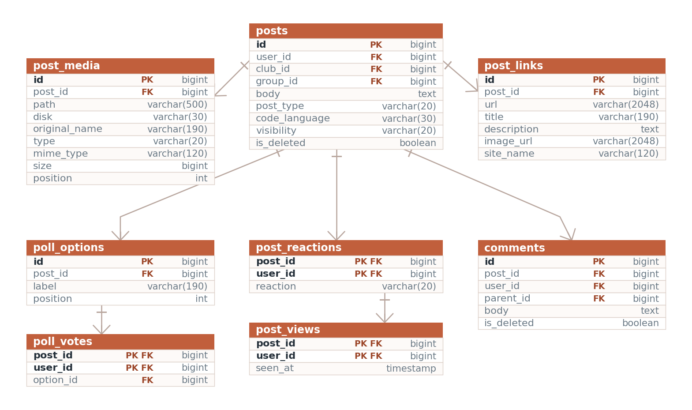
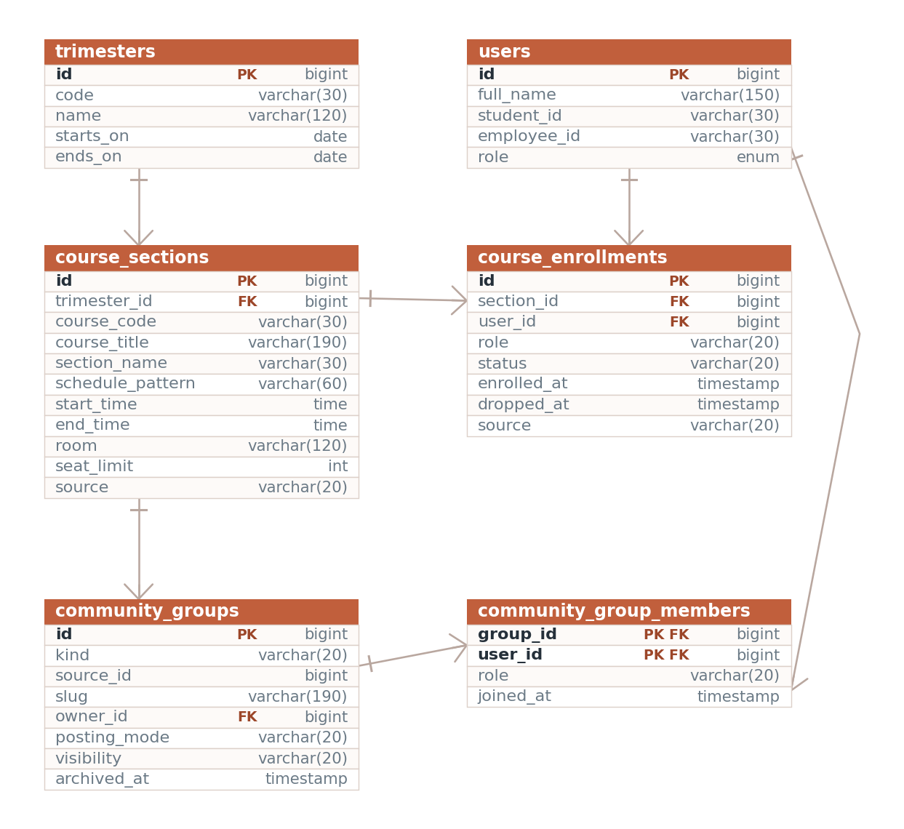
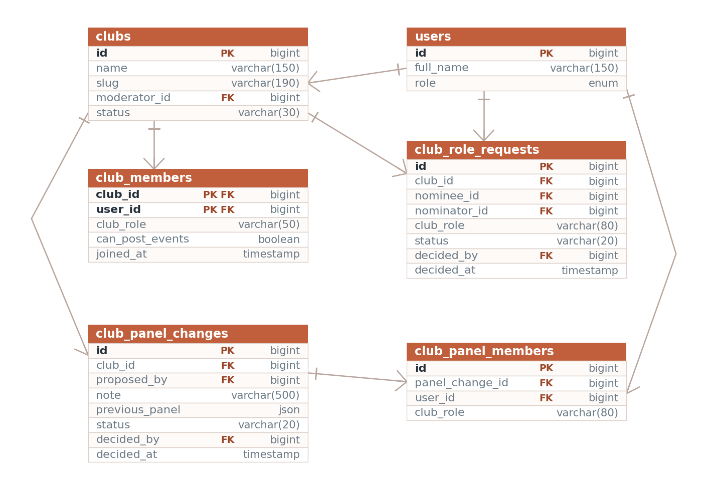
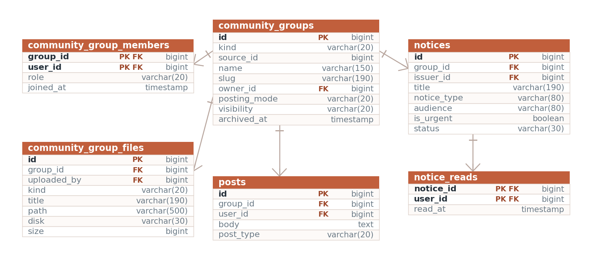

**UIU CampusConnect**

System Documentation

A social platform for United International University

September 2026

**Contents**

<<<CONTENTS>>>

<<<PAGEBREAK>>>

# 1. Introduction
UIU CampusConnect is a web application that brings the different parts
of university life into one place. Instead of scattering announcements
across notice boards, group chats and email, it gives every member of
the university a single account and a single site where they can read
the campus feed, follow official notices, join clubs, register for
events, buy and sell within the campus, report lost property, and
message each other.

The system recognises four kinds of account and treats them differently.
Students get the social side of the platform and can connect with other
students. Faculty members can reach anyone, and run the class group
behind each section they teach. University officials publish notices and
maintain the trimester\'s course sections. A developer administrator
maintains the platform itself and reviews anything that has been
reported.

## 1.1 Purpose of this document
This document explains how the system is built, where each feature lives
in the source code, how the screens connect to one another, and how the
database is organised. It is written so that any part of the application
can be traced from the page a user sees, through the route, controller
and model, down to the database tables involved.

The document is organised as follows.

-   Chapters 2 and 3 cover the technology used and how to install and
    run the system.

-   Chapter 4 explains the overall structure of the code and how a
    single request travels through it.

-   Chapter 5 covers roles and permissions, which affect almost every
    feature.

-   Chapter 6 is the site map, showing how the pages link together.

-   Chapter 7 is the database design, including the entity relationship
    diagrams.

-   Chapter 8 is the feature guide. This is the main reference: for each
    feature it states what it does, lists every file involved, traces
    one request end to end, and records the rules the code enforces.

-   Chapters 9 to 11 cover the landing page, the security measures, and
    the known limitations.

-   The appendices give a full route list, a file index for quick
    lookup, and the list of database tables. All four are generated
    from the source tree by docs/gen_appendices.py rather than
    maintained by hand, so they cannot drift away from the code.

Sections 4.5 and 8.19 cover two parts added after the first version of
the system: the React pages, and the picture galleries. Sections 8.13
and 8.14 cover the largest change since: the academic record, and the
three kinds of group built on top of it. Sections 8.20 to 8.22 cover the
newest work, all built on those groups: coursework, class chat, and the
campus assistant, whose security design is summarised in section 10.3.

## 1.2 Scope
The application covers fifteen functional areas: accounts and sign-in,
profiles, the social graph of connections and follows, private
messaging, the post feed, clubs, events, university notices, the
academic record of trimesters and course sections, groups, coursework,
class chat, a campus assistant that answers questions from a student's
own data, and two classified boards for the marketplace and lost
property. It also includes a moderation workflow and two separate
administrative interfaces.

The system is a web application only. There is no mobile application, no
email delivery in the default configuration, and no payment handling.
Files uploaded by users are stored on the local disk: pictures meant for
everyone on Laravel\'s public disk, and anything belonging to a group
of people - class materials, coursework, post documents - on the
private disk, served only after a permission check.

<<<PAGEBREAK>>>

# 2. Technology
## 2.1 Stack
  ------------------------------------------------------------------------
  **Layer**         **Technology**     **Role**
  ----------------- ------------------ -----------------------------------
  Language          PHP 8.3 or newer   Server-side application code

  Framework         Laravel 13         Routing, ORM, validation, sessions,
                                       caching

  Admin panel       Filament 5         Second administrative interface at
                                       /admin

  Database          MySQL 8 or MariaDB All persistent data
                    10.6               

  Templating        Blade              Server-rendered HTML

  Page framework    Inertia 3          Carries controller data straight
                                       into React pages

  Client framework  React 19           The converted pages, mounted by
                                       Inertia

  CSS               Tailwind CSS v4    Styling, compiled by Vite

  Client scripting  Alpine.js 3        Small interactive parts of the
                                       Blade pages

  HTTP client       Axios              Background requests from the
                                       browser

  3D graphics       Three.js r185      The campus scene on the landing
                                       and sign-in pages

  Syntax colouring  highlight.js 11    Code snippets in posts, coloured in
                                       the browser from its own Vite chunk

  Build tool        Vite 6             Compiles CSS and JavaScript

  Real-time         Laravel Reverb     Class chat over websockets; the
                    1.12, Laravel Echo page polls when the server is not
                    2                  running

  Language models   Groq, OpenRouter,  The campus assistant, tried in
                    Gemini, xAI,       order through one interface
                    DeepSeek
  ------------------------------------------------------------------------

## 2.2 Why these choices
Laravel supplies routing, an object relational mapper, validation,
session handling, file storage and caching as one coherent set, which
removes most of the boilerplate a project of this size would otherwise
need. Its Eloquent ORM maps each database table to a model class, so a
query such as fetching a post with its author, reactions and comments
reads as one chain of method calls rather than a hand-written join.

Filament is built on Laravel and generates administrative tables and
forms from a short class definition. It is used for the routine record
keeping (users, clubs, events, notices, reports, audit log) so that the
hand-written administrative pages could be reserved for the workflows
that need custom screens, such as the moderation queue.

Alpine.js covers the small interactive parts of a server-rendered page
directly in the markup: the composer dialog, the reaction bar, infinite
scroll, the messenger. It needs no component tree and no build step of
its own, which suits a page that is mostly static HTML.

The listing pages outgrew that. A page such as the network directory has
a search box, a role filter, pagination and four different per-person
actions, and in Blade each of those meant a full page reload. Those
pages were moved to React, with Inertia carrying the controller\'s data
into the component as props. Inertia was chosen over a separate API
because it keeps the routing, validation and authorisation in Laravel:
the controller still returns a response to a route, it simply returns a
page name and an array instead of a view. The two styles run side by
side, share one stylesheet, and look identical; section 4.5 explains how
a request reaches each of them.

## 2.3 Directory layout
  -----------------------------------------------------------------------------
  **Path**                       **Contents**
  ------------------------------ ----------------------------------------------
  app/Http/Controllers           One controller per feature area, 25 in total

  app/Http/Middleware            Request filters: forced password change, theme
                                 sharing, shared React props

  app/Models                     34 Eloquent models, one per main table

  app/Policies                   Ownership rules for posts and comments

  app/Services/SocialRules.php   Role rules for connections, messaging and club
                                 posting

  app/Support                    Notification sender, mention parser, gallery
                                 rules, generated covers

  app/Rules                      Custom validation rules

  app/Filament                   Admin panel resources, pages and widgets

  app/Providers                  Service registration, the admin gate, view
                                 composers

  resources/views                Blade templates, one folder per feature

  resources/views/components     Shared layout and card components

  resources/js                   Alpine components and the Three.js landing
                                 scene

  resources/js/Pages             React pages, one folder per feature area

  resources/js/Layouts           The shared React application shell

  resources/js/Components        React icon, avatar and pagination components

  resources/css/app.css          Tailwind theme and shared component classes

  routes/web.php                 Every URL in the application

  database/migrations            Schema definitions, grouped by feature area

  database/seeders               Demonstration data

  app/Console/Commands           Faculty import, data wipe and sample-content
                                 commands

  config                         Framework and application settings

  public                         Web root, compiled assets, uploaded files
  -----------------------------------------------------------------------------

<<<PAGEBREAK>>>

# 3. Installing and running the system
## 3.1 Requirements
-   PHP 8.3 or newer, with the pdo_mysql, gd, mbstring and fileinfo
    extensions enabled

-   Composer 2

-   Node.js 20 or newer with npm

-   MySQL 8 or MariaDB 10.6

## 3.2 First-time setup
composer install\
cp .env.example .env\
php artisan key:generate

Open .env and set the database name, user and password:

DB_DATABASE=uiu_campusconnect\
DB_USERNAME=root\
DB_PASSWORD=

Then create the schema, link the storage folder so uploaded files are
reachable, and build the front-end assets:

php artisan migrate \--seed\
php artisan storage:link\
npm install\
npm run build\
php artisan serve

The site is then available at http://127.0.0.1:8000.

## 3.3 Working on the code
While editing CSS or JavaScript, run npm run dev in one terminal and php
artisan serve in another. Vite then rebuilds assets as files change, so
the browser picks up edits without a manual build.

If a change to routes, configuration or views does not appear, clear the
framework caches:

php artisan optimize:clear

## 3.4 Loading accounts and sample content
Eight console commands manage the contents of the database. Each lives
in app/Console/Commands; Appendix B.6 lists them all. These are the ones
used to set a site up.

php artisan uiu:wipe-demo empties every content table and deletes every
account except the administrator. It refuses to run if no administrator
exists, so the system cannot be left with no way in.

php artisan uiu:import-faculty \<csv\> \--photos=\<dir\> creates one
account per row of the faculty list, hashing a temporary password and
setting must_change_password so each member of staff must choose their
own on first sign-in. Running it again updates names and departments but
never touches a password that has already been changed. Pass \--dry-run
first to see what it would do. The CSV holds one-time passwords in plain
text, so it must be kept outside the project folder and deleted once the
import has run.

php artisan uiu:demo-content fills an empty site with sample students,
clubs, events, marketplace listings, lost property and notices, which is
what makes the pages worth looking at before real use begins. Everything
it creates belongs to accounts on the demo.uiu.test domain, so php
artisan uiu:demo-content \--wipe removes all of it and leaves the real
records untouched.

The sample accounts share one password, printed when the command runs.
They exist for testing only and must be removed with \--wipe before
anybody else can reach the site.

### Setting up the academic side
A site with accounts still has no classes in it. Three more commands
build the academic record, and they run in this order:

    php artisan uiu:trimester "Fall 2026" --code=2026-3 \
        --start=2026-09-01 --end=2026-12-12

    php artisan uiu:import-enrolments storage/rosters/fall-2026.csv --dry-run
    php artisan uiu:import-enrolments storage/rosters/fall-2026.csv

    php artisan uiu:sync-club-groups

uiu:trimester creates or updates a teaching term.
uiu:import-enrolments reads a class list and writes the sections, the
enrolments and the class group behind each one; \--dry-run reports what
it would do and writes nothing, which is how a roster should always be
run the first time. uiu:sync-club-groups does the same job for clubs,
giving each active one a group.

Two more are housekeeping rather than setup.
uiu:archive-course-groups turns class groups read-only twenty days after
their trimester ended, and is the command to put on a schedule.
uiu:secure-group-files moves any group file still sitting on the
publicly readable disk onto the private one; it is a one-off for sites
that ran an early version, and takes \--dry-run.

### Replacing the sample content with the real thing

    php artisan uiu:seed-uiu-data --dry-run
    php artisan uiu:seed-uiu-data

uiu:seed-uiu-data swaps the invented clubs, notices and events for the
real ones: the 24 clubs, forums and societies UIU lists, the notices on
the university board with the dates they carry there, and the events
from its events page. It also sets the trimester from the published
academic calendar. Every row carries the address it came from, and
docs/UIU-Real-Data-Sources.pdf separates what was sourced from what
this project assigned or dated itself.

It is safe to run again - clubs match on slug, notices and events on
title - and it fills rather than overwrites: a club that already has a
logo or a picture is left alone, so nothing uploaded through the club
page is lost.

Club logos and banners are picked up from storage/app/seed-logos/ and
storage/app/seed-covers/, named after the club's slug. A club with no
file keeps its generated initials badge, which is honest about not
having the real thing.

  -----------------------------------------------------------------------
  **Role**                 **Email**
  ------------------------ ----------------------------------------------
  Administrator            admin@uiu.ac.bd

  Student                  tanvir@demo.uiu.test

  Student                  mehjabin@demo.uiu.test

  Official, Registrar desk registrar.office@demo.uiu.test
  -----------------------------------------------------------------------

<<<INCLUDE setup_new.md>>>

<<<PAGEBREAK>>>

# 4. How the application is put together
## 4.1 The pattern
The application follows the Model, View, Controller pattern that Laravel
is built around. A URL is matched to a controller method by the route
file, the controller asks one or more models for data, and it passes
that data to a Blade view which produces the HTML.

Three additional layers sit alongside those three, and knowing where
they are saves a lot of searching:

-   **Middleware** runs before the controller and can redirect the
    request. ForcePasswordChange sends any account holding a temporary
    password to the password screen, and ShareThemePreference reads the
    theme cookie so the correct light or dark class is on the page from
    the first byte.

-   **Services and support classes** hold logic that more than one
    controller needs. SocialRules answers questions such as whether one
    user may message another. Notifier creates notification rows.
    Mentions parses \@name out of a post body.

-   **Policies** hold ownership rules. PostPolicy and CommentPolicy
    decide whether the current user may edit a given record.

## 4.2 The path of one request
Following a single request end to end shows how the layers fit together.
The example is a student opening the feed.

1.  The browser requests GET /feed.

2.  routes/web.php matches the URL inside the auth middleware group and
    names the route feed.index.

3.  Laravel confirms a session exists. ForcePasswordChange checks the
    must_change_password flag and lets the request through.

4.  FeedController::index runs. It reads the tab and cursor from the
    query string.

5.  The controller calls scopes on the Post model. scopeVisible removes
    deleted posts, scopeForViewer removes hidden, muted and blocked
    authors, and scopeRankedFor orders what remains by the ranking
    expression.

6.  The resulting post identifiers are cached so that later scrolling
    pages through the same ordered list rather than re-ranking.

7.  The controller loads the posts with their authors, reactions,
    comments and media in one query set, then adds the sidebar data: the
    latest notice, the next three events and three clubs to suggest.

8.  It returns view(\'feed.index\', \...). Blade renders
    feed/index.blade.php, which includes feed/\_posts.blade.php, which
    includes feed/\_post.blade.php once per post.

9.  The finished HTML is sent to the browser, where Alpine attaches the
    interactive behaviour: the composer, the reaction bars, and the
    observer that loads the next batch.

## 4.3 How the browser talks back
Most actions do not reload the page. Reacting to a post, saving it,
sending a message and posting a comment all send a background request
with Axios and update the page in place.

The trick that keeps this simple is in
app/Http/Controllers/Controller.php. Its respond method checks whether
the request expects JSON. If it does, the controller returns a small
JSON object; if not, the same controller method returns a normal
redirect. Every action therefore works with JavaScript switched off, and
no controller has to be written twice.

The same method serves the React pages without alteration. An Inertia
request sends Accept: text/html, so expectsJson() is false and the
controller redirects back as it would for a plain form. Inertia follows
the redirect and re-renders the page it came from, which is why actions
such as registering for an event or accepting a connection needed no
server-side change when their pages were converted.

## 4.4 Shared page furniture
Every signed-in Blade page is wrapped in
resources/views/components/app-layout.blade.php. That single file
provides the sidebar, the header with search box, the notification bell,
the theme toggle, the mobile navigation bar and the floating messenger
widget. Adding a page to the navigation means editing this one file.

Two view composers registered in app/Providers/AppServiceProvider.php
supply the numbers on the sidebar badges: the unread message and
notification counts, and the count of pending connection applications.
Because they are composers, every view receives them without any
controller having to pass them.

The React pages have the same shell written once more in
resources/js/Layouts/AppLayout.jsx, and the same badge numbers reach it
as shared props rather than as view composers. The two files are kept
deliberately identical in markup and class names, so a visitor moving
between a Blade page and a React page sees no seam.

## 4.5 How a React page is served
Fifteen pages are React rather than Blade: the nine listing pages, the
four administrative screens, the course sections page and the account
settings page. Appendix B.5 lists the files. The route, the middleware, the authorisation and the
queries are unchanged; only the last line of the controller differs.

1.  The browser requests GET /network.

2.  The route and the auth middleware behave exactly as in section 4.2.

3.  NetworkController::index runs its queries as before.

4.  Instead of view(\...) it returns Inertia::render(\'Network/Index\',
    \[\...\]), naming a component under resources/js/Pages and the data
    it needs.

5.  HandleInertiaRequests adds the props every page receives: the
    signed-in user, the sidebar badge counts, any flash message and the
    theme.

6.  On a first visit Laravel returns resources/views/app.blade.php, a
    nearly empty document holding the page data as JSON. On any later
    visit Inertia asks for the same URL over XHR and receives only the
    JSON.

7.  resources/js/inertia.jsx resolves the component name to a file,
    mounts it, and passes the data in as props.

Two consequences are worth remembering when changing this code. First,
the controller must decide everything the page needs, because a React
component cannot call a model; this is why the controllers for converted
pages build explicit arrays rather than passing Eloquent objects.
Second, INERTIA_ROUTES at the top of AppLayout.jsx lists the paths that
are React, and the sidebar only uses an in-page navigation for those.
The list is matched exactly, because a converted listing such as /clubs
usually still has a Blade detail page beneath it.

### Pages that are React
  -----------------------------------------------------------------------
  **Path**                 **Component**
  ------------------------ ----------------------------------------------
  /network                 Pages/Network/Index.jsx

  /connect-requests        Pages/ConnectRequests/Index.jsx

  /clubs                   Pages/Clubs/Index.jsx

  /events                  Pages/Events/Index.jsx

  /groups                  Pages/Groups/Index.jsx

  /notices                 Pages/Notices/Index.jsx

  /notifications           Pages/Notifications/Index.jsx

  /marketplace             Pages/Marketplace/Index.jsx

  /lost-found              Pages/LostFound/Index.jsx

  /developer-admin         Pages/Admin/Center.jsx

  /user-approvals          Pages/Admin/UserApprovals.jsx

  /moderation              Pages/Admin/Moderation.jsx

  /password-requests       Pages/Admin/PasswordRequests.jsx

  /administration          Pages/Administration/Index.jsx

  /settings/password       Pages/Settings/Password.jsx
  -----------------------------------------------------------------------

Everything else, including the feed, private messages, search, all
profile pages and every detail page, is still Blade.

A third consequence follows from mixing the two. A controller that
redirects on success must land on a page of the same kind.
SettingsController::updatePassword originally redirected to the feed;
once the settings page became React that redirect crossed into Blade and
the confirmation never appeared, so it now returns to the settings page
instead. Every redirect()-\>route(\...) should be checked before its
page is converted.

<<<PAGEBREAK>>>

# 5. Roles and permissions
Almost every feature behaves differently depending on who is looking at
it, so the permission model is worth understanding before the feature
guide.

## 5.1 The two columns that decide everything
Permissions come from two columns on the users table.

role is the broad category and holds one of four values: student,
faculty, official or admin. authority_level is a finer label within that
category, and the values used by the code are vc, pro_vc, dean,
registrar, developer, club_moderator, faculty, official and member.

A third column, status, decides whether the account may be used at all.
Only active accounts can sign in.

## 5.2 What each role may do
  --------------------------------------------------------------------------------
  **Action**     **Student**       **Faculty**    **Official**      **Admin**
  -------------- ----------------- -------------- ----------------- --------------
  Read the feed, Yes               Yes            Yes               Yes
  post, comment,                                                    
  react                                                             

  Send a         Yes               Yes            Yes               No
  connection                                                        
  request to a                                                      
  student                                                           

  Send a         Only through an   Faculty to     Official to       No
  connection     admin-reviewed    faculty is     official is       
  request to     application       accepted at    accepted at once  
  faculty or an                    once                             
  official                                                          

  Start a        Only with         With anyone    Only with         Cannot use
  conversation   accepted                         accepted          messaging
                 connections                      connections       

  Join clubs and Yes               Yes            Yes               Yes
  groups,                                                           
  register for                                                      
  events                                                            

  Publish a club Only with         Also if club   Only with         Yes
  event          can_post_events   moderator of   can_post_events   
                 on the membership that club                        

  Publish a      No                Only vc,       No                Yes
  university                       pro_vc or dean                   
  event                                                             

  Publish a      No                No             Only registrar or Yes
  notice                                          developer         

  Manage course  No                No             Only registrar or Yes
  sections                                        developer         

  Post on a      If the teacher    Yes, in their  Yes, in their     Yes
  class group    has opened the    own sections   own groups        
  wall           group                                              

  Put slides or  No                In their own   In their own      Yes
  a notice in a                    sections       groups            
  class group                                                       

  Propose a new  Only the club     Only if club   Only if club      Yes
  club panel     President         moderator      moderator         

  Approve a      No                Only if club   Only if club      Yes
  panel or an                      moderator      moderator         
  officer                                                           

  Change a       No                No             No                Yes
  club\'s faculty                                                    
  moderator                                                         

  Review         No                No             No                Yes
  reports,                                                          
  approve                                                           
  accounts,                                                         
  suspend users                                                     
  --------------------------------------------------------------------------------

## 5.3 Where each rule is written
  -----------------------------------------------------------------------
  **Rule**                 **File and method**
  ------------------------ ----------------------------------------------
  Who may connect with     app/Services/SocialRules.php,
  whom                     canRequestConnection

  Who may message whom     app/Services/SocialRules.php, canMessage

  Who may manage a club    app/Services/SocialRules.php, canManageClub

  Who may post a club      app/Services/SocialRules.php, canPostClubEvent
  event                    

  Who may post a           app/Models/User.php, canPostUniversityEvent
  university event         

  Who may issue notices    app/Models/User.php, canIssueNotices

  Who may manage course    app/Models/User.php,
  sections                 canIssueSectionAnnouncements

  Who may propose,         app/Services/SocialRules.php,
  approve or cancel a      canProposeClubPanel, canApproveClubPanel,
  club panel               clubPresident, isClubPresident

  Who may nominate a club  app/Services/SocialRules.php,
  officer                  canNominateClubOfficer, isClubOfficer

  Who may replace a        app/Services/SocialRules.php,
  club\'s moderator         canChangeClubModerator

  What each person may do  app/Models/CommunityGroup.php, canRead,
  in a group               canPost, canPublish, canUpload, canManage

  Who owns a post or       app/Policies/PostPolicy.php,
  comment                  app/Policies/CommentPolicy.php

  Administrator override   app/Providers/AppServiceProvider.php, the
                           Gate::before closure

  Who may open the         app/Models/User.php, canAccessPanel
  Filament panel           
  -----------------------------------------------------------------------

Keeping these in named methods rather than inline conditions means a
rule can be checked in a controller and in a Blade template without
being written twice, and it means the whole permission model can be read
in a handful of files.

The group permissions are the exception to "in SocialRules": they live
on the CommunityGroup model itself, because every one of them needs the
group\'s own kind, posting mode and archived state to answer, and a
rule that needs the object is better asked of the object.

## 5.4 The administrator override
AppServiceProvider::boot registers a gate that runs before every policy:

Gate::before(fn (\$user, \$ability) =\> \$user-\>isAdmin() ? true :
null);

Returning true grants the ability outright; returning null lets the
normal policy decide. The effect is that an administrator passes every
ownership check, so the policies themselves only have to describe the
owner\'s rights. The SocialRules methods make the opposite choice: they
deliberately exclude administrator accounts from connections and
messaging, so an administrator account is a maintenance account and not
a social one.

<<<PAGEBREAK>>>

# 6. Site map and page connections
Figure 1 shows every screen in the application and the links between
them. Arrows mark a link that exists in the markup of one page pointing
at another. On top of these links, every signed-in page carries the
sidebar, so the main sections are always one click away from anywhere in
the application.

## 6.1 Reading the map
The application has three entry points and one hub.

**Guest pages.** A visitor who is not signed in lands on the Three.js
landing page at /. From there the only routes forward are the sign-in
form and the account recovery form. FeedController::welcome checks for a
session first, so a signed-in visitor who opens / is redirected straight
to the feed. Signing out returns the user to the landing page rather
than the sign-in form.

**The hub.** After sign-in every user arrives at /feed. The feed is the
only page that pulls content from several modules at once: posts under
six tabs in the centre, upcoming events and suggested clubs in the right
rail, and the deadlines and shuttle cards below them.

**Feature pages.** Each module follows the same two-level shape: an
index page that lists and filters, and a detail page for one record.
Clubs, events, notices, groups, marketplace and lost and found are all
built this way, which means once one of them is understood the others
read the same.

**One link that leaves.** The sidebar\'s last entry, UCAM EMS, is not a
page of this application at all: it opens the university\'s existing
enrolment system at ucam.uiu.ac.bd in a new tab. It is there because
students go to both in the same sitting, and asking them to keep a
bookmark for one of them is the kind of small friction that decides
whether a site gets used.

**Administrative pages.** The admin centre at /developer-admin is the
entrance to the administrative screens. It does not duplicate their
work; it shows counters and links out to the moderation queue, user
approvals, password requests, connection applications, the course
sections page and the Filament panel.

## 6.2 Where the paths cross
Three pages are reached from many different places, and they are worth
knowing because they carry most of the cross-linking.

-   **The profile page** is linked from every list of people: the feed,
    search, the network directory, connection requests, group and club
    member lists, and both moderation screens.

-   **The messages page** is the destination of every \"contact\"
    action. Marketplace listings and lost property claims both link to
    messages.index with a ?with= parameter that opens the right
    conversation.

-   **The post detail page** is where notifications land.
    notifications.go resolves the entity a notification refers to and
    redirects, adding an anchor such as #comment-42 when the
    notification was about a comment. A post that belongs to a group is
    the one exception: members are redirected to the group\'s wall,
    and everybody else gets a 404.

-   **The Applications page** now carries three different kinds of
    pending thing: connection applications, club officer nominations
    waiting for the nominee, and panel handovers the viewer proposed.

{width="9.864583333333334in"
height="6.416666666666667in"}

*Figure 1. The pages of the application and the links between them.*

<<<PAGEBREAK>>>

# 7. Database design
The schema holds 53 tables. Five of those belong to the framework and
store cache entries, queued jobs and job batches; the remaining 48 hold
application data. Figure 2 groups them by module, and Figures 3 to 8
give the columns and relationships of each group in turn.

## 7.1 Users, profiles and the social graph
users holds identity, role and account state. Everything that describes
a person but is not needed on every query lives in user_profiles, which
uses user_id as its primary key rather than a surrogate identifier.

Relationships between people are stored in four separate tables because
they mean four different things. friendships is a mutual link with a
status and one row per pair. user_follows is one-directional and needs
no status. user_blocks hides content in both directions and is checked
on almost every query. user_mutes hides an author temporarily and
carries an expires_at that may be null for a permanent mute.
connection_applications records the student request that an
administrator must approve before a student and a faculty member can be
connected. See Figure 3.

## 7.2 Posts and engagement
posts is the centre of the feed. A post can carry several attachments,
so post_media holds one row per file with a position column that
preserves the order they were uploaded in, plus the disk it was written
to, its original name, its mime type and its size. The older media_type
and media_path columns on posts itself mirror the first attachment.

post_type says which of the four kinds a post is - standard, poll, code
or shared - and code_language carries the language of a snippet. A link
found in the body gets one post_links row holding the URL, title,
description and image; it is a separate table rather than four more
columns on posts, because most posts have no link at all and the row is
written after the post already exists.

posts.group_id is what puts a post on a group wall instead of in the
campus feed. Post::scopeVisible excludes every post that has one, so a
class wall is invisible to the feed, to search and to profiles by
default rather than by remembering to filter.

Every kind of engagement has its own table. The ones that can happen
only once per person per post, which is reactions, saves, hides and
views, use a composite primary key of the two identifiers instead of an
auto-incrementing one, so the database itself enforces the rule. Polls
are two tables: poll_options for the choices and poll_votes for the
answers, with a unique constraint that gives each voter one vote per
post. See Figure 4.

## 7.3 The academic record
Three tables carry the university\'s own structure. trimesters is a
teaching term with a unique code and its first and last teaching day.
course_sections is one section of one course inside a trimester, with
its schedule, room, seat limit and a source column recording whether it
came from the roster import or was typed into /administration.
course_enrollments joins a person to a section with a role of student or
teacher and a status of active or dropped.

There is no teachers table. The teacher of record is an enrolment row
with role teacher, so \"who is in this section\" is one query for
everybody in it, and a class group\'s membership is a direct read of
that table. A dropped enrolment is kept rather than deleted, with
dropped_at, because a roster that forgets is a roster that cannot be
reconciled against the next import.

## 7.4 Clubs, events and notices
Clubs and events are linked in two directions: an event may belong to a
club through events.club_id, and a post may belong to a club through
posts.club_id. Membership is a pivot table that carries club_role and a
can_post_events flag, which is what allows an ordinary member to publish
on the club\'s behalf without changing their role anywhere else.

The student panel is held in club_members.club_role rather than in
columns on clubs, and two tables record how it changes.
club_role_requests is a single nomination waiting for the moderator;
club_panel_changes with its child club_panel_members is a whole slate
proposed at once, carrying the previous panel as JSON so an approved
handover keeps a record of what it replaced. clubs.moderator_id is the
faculty adviser, and nothing in either of those tables touches it.

Events have three separate participation tables rather than one with a
status column, because registering, marking interest and checking in are
independent of each other: a person may be interested without
registering, and may check in whether or not they registered.

Notices carry their own attachments table and a set of targeting
columns - audience, department, batch and semester - which decide who is
notified when one is published. notices.group_id, when set, scopes a
notice to one group: it then shows inside that group and, on the
university board, only to that group\'s members. notice_reads is a plain
(notice_id, user_id, read_at) table, and the unread count beside Groups
in the sidebar is the group-scoped notices with no row in it. See
Figure 5.

## 7.5 Groups, marketplace and lost property
These three boards are the simplest part of the schema. Each has an
items table owned by a user, and where a response is possible there is
one child table for it: community_group_files for uploads to a group,
and lost_found_claims for someone saying they have found or lost an
item. Groups and clubs both use a slug column for their URLs rather than
the numeric identifier.

community_groups carries the columns that make the three kinds of group
work. kind is course, club or open. source_id points at the
course_sections or clubs row a derived group stands for, and the pair
(kind, source_id) is what makes syncing idempotent. posting_mode is
staff or everyone - the teacher\'s decision about whether their class
talks back. archived_at is set twenty days after a trimester ends and
turns the room read-only. visibility is private for every class group,
because a class list is not public reading.

community_group_files carries a kind column separating materials put up
by staff from files shared by members, and the disk the file was written
to - which is the private one, for every group file.

lost_found_items carries two columns about how a case ended. resolved_at
is when it was marked reunited and resolved_by is who marked it, which
is either the person who posted it or an administrator acting for them.
Keeping the time separately from updated_at is what allows the reunited
list to be ordered by when each case was settled rather than by when the
row was last touched. See Figure 6.

## 7.6 Pictures
Events, clubs, notices, marketplace listings and lost property items can
all carry more than one picture, and rather than five nearly identical
tables they share one. media is polymorphic: mediable_type holds the
model class name and mediable_id its primary key, the same convention
the mentions table already used. position decides the order, and
position zero is the cover the listing pages show.

There is no foreign key on that pair, because a foreign key can only
point at one table. The trade-off is that the database cannot delete a
picture row automatically when its owner is deleted, so the code that
removes an owner removes its media first. Figure 8 shows the table and
the five it serves.

Each of those five tables still has the single image column it had
before galleries existed, such as events.poster_path. Those columns are
read as a fallback when a row has no media rows at all, which is what
keeps records created before the change showing their picture. New
uploads only ever write media rows.

## 7.7 Reports, notifications and the audit trail
Reports are kept in three separate tables rather than one polymorphic
table, because a report against a post, a comment and a profile each
need different columns and are resolved by different actions. All three
share the same status vocabulary, so the moderation queue can treat them
alike.

notifications is written by one class, app/Support/Notifier.php, and
carries a group_count column so that repeated activity on the same item
can be folded into a single row rather than filling the list. audit_logs
records administrator actions with the actor, the action, and the record
affected. See Figure 7.

{width="10.510416666666666in"
height="5.0625in"}

*Figure 2. The tables grouped by module.*

{width="9.9375in"
height="6.416666666666667in"}

*Figure 3. Accounts, profiles, connections and messaging.*

{width="10.2in"}

*Figure 4. Posts, attachments, link previews, polls, comments and
reactions.*

{width="9.625in"
height="6.416666666666667in"}

*Figure 5. Clubs, events and notices.*

{width="10.427083333333334in"
height="6.416666666666667in"}

*Figure 6. Community groups, marketplace listings and lost property.*

{width="10.427083333333334in"
height="6.416666666666667in"}

*Figure 7. The moderation and notification tables.*

{width="10.510416666666666in"
height="5.25in"}

*Figure 8. The media table and the five kinds of record it holds
pictures for.*

{width="9.6in"}

*Figure 9. Trimesters, course sections, enrolment, and the class group
each section produces.*

{width="9.6in"}

*Figure 10. How a club\'s leadership changes: a single nomination, and a
whole panel proposed at once.*

{width="10.2in"}

*Figure 11. A group, its members, its wall, its shelf and its notices.*

## 7.8 Conventions used throughout the schema
**Primary keys.** Most tables use an auto-incrementing id. Join tables
that record a fact about a pair of records use a composite primary key
instead, which makes the \"only once\" rule a database constraint rather
than something the application has to remember. post_reactions,
post_saves, post_views, hidden_posts, comment_likes, user_follows,
user_blocks, user_mutes, club_members, event_registrations,
event_interests, event_checkins and community_group_members all work
this way.

**Foreign keys.** Every foreign key is declared with cascadeOnDelete, so
removing a post removes its media, poll options, reactions and comments
with it. The few columns that may legitimately be empty, such as
posts.club_id and notifications.actor_id, are nullable and use
nullOnDelete. The one exception is the media table, whose link to its
owner is a class name and an identifier rather than a foreign key, and
so has to be cleaned up in code.

**Soft deletion.** Posts and comments are never removed from the table.
They carry is_deleted and deleted_reason, and the visible scope filters
them out. This keeps the reply chain intact when a parent comment is
removed, and preserves the record of what a moderator acted on.

**Status columns.** Records that move through a workflow carry a status
string rather than a boolean, so a third state can be added without a
migration. The values in use are:

  -------------------------------------------------------------------------
  **Table**                  **Status values**
  -------------------------- ----------------------------------------------
  users                      active, pending, suspended, rejected

  friendships                pending, accepted

  connection_applications    pending, reviewing, approved, rejected,
                             cancelled

  club_membership_requests   pending, approved, rejected

  clubs                      active, inactive

  events                     published, cancelled

  notices                    published, archived

  reports, comment_reports,  open, reviewing, resolved, dismissed
  profile_reports            

  marketplace_items          available, sold

  lost_found_items           open, resolved

  password_reset_requests    pending, approved, rejected
  -------------------------------------------------------------------------

**Timestamps.** Most tables carry the usual created_at and updated_at
pair. Tables that are written once and never modified, such as
notifications, mentions, post_media and audit_logs, keep only created_at
and set \$timestamps = false on their model.

**Migration files.** Migrations are grouped by feature rather than one
file per table.
0001_01_02_000001_create_posts_and_engagement_tables.php, for example,
creates posts and every table that hangs off it, so the whole feature
can be read in one place. Later additions are separate files with names
that state what they add.

<<<INCLUDE schema_new.md>>>

<<<PAGEBREAK>>>

# 8. Feature guide
This chapter is the main reference for finding code. Each feature is
described the same way: what a user sees, a table naming every file
involved, a numbered trace of one request from the browser to the
database and back, the rules the code actually enforces, and the pages
it links to.

Route names rather than line numbers are used throughout, because a
route name is stable when the file is edited. To find a route, search
routes/web.php for its name.

## 8.1 Authentication and sign-in
**What it does.** Users sign in at /signin with an email and password.
There is no public sign-up form; accounts are created by the university.
A sign-in attempt is refused if the account status is not active, with a
different message for a pending, suspended or rejected account. Anyone
who cannot sign in files a recovery request at /forgot-password, which
an administrator reviews and answers by issuing a randomly generated
temporary password shown to the administrator once. An account holding a
temporary password is redirected to the password screen until it is
changed. Administrators approve, reject, suspend and reactivate accounts
at /user-approvals.

### Where the code is
  -----------------------------------------------------------------------
  **Layer**                **File**
  ------------------------ ----------------------------------------------
  Routes                   login, login.attempt, logout,
                           password.request, password.request.store,
                           password-requests.index,
                           password-requests.review,
                           user-approvals.index, user-approvals.review

  Controllers              Auth/LoginController.php (create, store,
                           destroy), PasswordResetRequestController.php
                           (create, store, index, review,
                           temporaryPassword), UserApprovalController.php
                           (index, review)

  Models                   User.php, PasswordResetRequest.php

  Views                    auth/login.blade.php,
                           auth/forgot-password.blade.php

  React pages              Pages/Admin/PasswordRequests.jsx,
                           Pages/Admin/UserApprovals.jsx

  Supporting               Http/Middleware/ForcePasswordChange.php,
                           Rules/UiuEmail.php, the login rate limiter in
                           Providers/AppServiceProvider.php

  Tables                   users, password_reset_requests
  -----------------------------------------------------------------------

### How it works
1.  GET /signin reaches LoginController::create, which returns the
    auth.login view. The route sits in the guest group, so a signed-in
    visitor is redirected away.

2.  POST /signin reaches LoginController::store through the
    throttle:login middleware. That limiter is defined in
    AppServiceProvider::boot as eight attempts per fifteen minutes,
    keyed on the lower-cased email plus the client IP address.

3.  store validates the email and password, loads the user by
    lower-cased email, and checks the password with Hash::check. A miss
    returns the generic message \"Those credentials don\'t match an
    account.\"

4.  If the account status is not active, a match expression picks the
    message for pending, suspended or rejected and returns it as an
    error. No session is created.

5.  On success the controller calls Auth::login, regenerates the session
    identifier to defeat session fixation, stamps last_login_at, and
    redirects to the intended URL or to feed.index.

6.  On the next request ForcePasswordChange runs. If
    must_change_password is set and the route is not the password screen
    or sign-out, it redirects to settings.password with a warning.

7.  For recovery, PasswordResetRequestController::store looks the
    submitted identifier up against email, student_id and employee_id,
    and stores a pending row with the request IP address. The
    confirmation message is the same whether or not a user matched, so
    the form cannot be used to discover which accounts exist.

8.  PasswordResetRequestController::review generates a twelve-character
    password, hashes it, sets must_change_password, marks the request
    approved, and flashes the plain password once so the administrator
    can pass it on.

### Key rules
-   Only active accounts can sign in. The other statuses are pending,
    suspended and rejected.

-   Sign-in is limited to 8 attempts per 15 minutes per email and IP
    pair. Recovery requests are limited to 6 per minute.

-   The temporary password alphabet excludes characters that look alike,
    and TEMP_LENGTH is 12.

-   Only one open recovery request is allowed per account. A request
    that matched no account is still stored, with a null user_id, and
    approving it returns an error telling the administrator to reject it
    instead.

-   A request that has already been reviewed cannot be reviewed again.

-   Both administrative screens call
    abort_unless(\$request-\>user()-\>isAdmin(), 403) before doing
    anything.

-   UserApprovalController::review refuses to act on an account whose
    role is admin. Approval sets the status to active, marks the account
    verified, and fills authority_level from the role if it is empty.

-   Signing out invalidates the session, regenerates the token, and
    returns to the landing page rather than the sign-in form.

### How the two auth pages look
Both /signin and /forgot-password run the landing page\'s 3D campus
scene behind them rather than sitting on a flat panel. The shell is the
same on both, so following the link between them does not feel like
moving to a different site:

-   \<body\> carries the cc-stage class, which paints the sky-to-grass
    gradient the scene fades in over, and a dark variant of it.

-   A full-bleed \#cc-landing-canvas is mounted behind everything at
    -z-10, and resources/js/landing.js draws the same scene it draws on
    the landing page.

-   A gradient scrim sits over the canvas so white text stays legible
    whatever the scene is doing behind it.

-   The content is a two-column grid: the university name and the line
    *\"The campus, connected.\"* on the left, the form card on the
    right. Below the large breakpoint the left column is hidden and a
    short heading takes its place.

-   The form itself sits on a translucent, blurred card so it reads as a
    panel over the scene rather than a hole cut in it.

landing.js gained two guards for this. It respects
prefers-reduced-motion, and it finds its container with
canvas.closest(\'.cc-stage\') \|\| canvas.parentElement rather than
assuming the landing page\'s own markup. If WebGL is unavailable the
stage sets data-fallback and the canvas is hidden, leaving the gradient
- which is why the gradient is a real background and not something the
scene paints.

The left-hand column is deliberately two lines. An earlier version
listed what the site offers, which read as instructions to somebody who
had only come to sign in.

### Connected pages
The landing page links to login; login links to password.request. A
successful sign-in lands on feed.index. admin-center.index links to
password-requests.index and user-approvals.index, and
user-approvals.index links out to profile.show.

## 8.2 Profiles and settings
**What it does.** Every user has a profile at /profile/{user} with a
cover image, avatar, counts for friends, followers, posts and photos,
and six tabs: All, About, Friends, Photos, Posts and More. The owner
edits their details at /settings/profile, including four privacy toggles
and both images; faculty, officials and administrators also get office
hours, research interests, courses taught and academic resources.
Passwords are changed on a separate screen. The light and dark
preference is a cookie written by POST /theme and read back on the
server, so the correct theme is present in the first response.

### Where the code is
  -----------------------------------------------------------------------
  **Layer**                **File**
  ------------------------ ----------------------------------------------
  Routes                   profile.me, profile.show, profile.edit,
                           profile.update, profile.report,
                           settings.password, settings.password.update,
                           theme.update

  Controllers              ProfileController.php (me, show, edit, update,
                           report), SettingsController.php (passwordForm,
                           updatePassword), ThemeController.php

  Models                   User.php, UserProfile.php, Post.php,
                           ProfileReport.php

  Views                    profile/show.blade.php, profile/edit.blade.php

  React pages              Pages/Settings/Password.jsx

  Supporting               Http/Middleware/ShareThemePreference.php,
                           Services/SocialRules.php, the theme helpers in
                           resources/js/app.js, the cookie exclusion in
                           bootstrap/app.php

  Tables                   users, user_profiles, friendships,
                           user_follows, posts, club_members, clubs,
                           profile_reports
  -----------------------------------------------------------------------

### How it works
1.  GET /profile/{user} resolves the user by route model binding and
    calls ProfileController::show.

2.  The method checks the requested tab against a fixed list and runs
    only the queries that tab needs, so opening the About tab does not
    fetch photos.

3.  The friends list is a query against friendships that selects
    whichever side of the row is not the profile owner, filtered to
    accepted rows and active accounts.

4.  Club rows come from club_members joined to active clubs, and the
    first two roles that are not plain membership are shown as badges.

5.  The view is given the friendship record, whether a connection may be
    requested, whether a message may be sent, and whether the viewer
    follows this person. It uses those four values to decide which
    buttons to render.

6.  PUT /settings/profile runs ProfileController::update, which
    validates eighteen fields, writes name, department and designation
    onto users, and creates or updates the matching user_profiles row.

7.  Uploaded avatar and cover images are stored on the public disk under
    profiles and covers, and their paths are merged into the same
    update.

8.  For the theme, the header button writes the cookie in JavaScript and
    posts to /theme. ThemeController accepts only light or dark and
    reissues the cookie for one year. On the next request
    ShareThemePreference reads it and shares the value with every view.

### Key rules
-   Privacy flags live on user_profiles. show_email, show_student_id and
    show_friend_list default to true; show_phone defaults to false. The
    owner always sees their own details.

-   Avatar and cover uploads must be images and are capped at 10 MB
    each.

-   The academic block on the edit form renders only for faculty,
    official and administrator accounts.

-   UserProfile uses user_id as its primary key and does not
    auto-increment.

-   Changing a password requires the current password, a confirmation
    field and a minimum of six characters. Success clears
    must_change_password and stamps password_changed_at.

-   A profile report is stored with updateOrCreate keyed on the reported
    user, the reporter and the open status, so repeated reports update
    one row instead of filling the queue.

-   The theme cookie is deliberately excluded from Laravel\'s cookie
    encryption in bootstrap/app.php, because the browser has to read it
    before the page paints.

### Connected pages
profile.show links to profile.edit, settings.password, clubs.show,
messages.index, connect-requests.index, and posts to every network.\*
action. It is linked from the feed, search, the network directory,
connection requests, club and group member lists, and both moderation
screens.

## 8.3 Network and connections
**What it does.** /network is a searchable, role-filtered directory of
active users. Each card offers the action that applies: Connect, Accept,
Decline, Unfriend, Message, or a link to apply for permission to
connect. Friendships are one row with a status; following, blocking and
muting are separate one-way relations. Students cannot befriend faculty
or officials directly. Instead they file an application at
/connect-requests which only an administrator can approve, and approval
creates the accepted friendship.

### Where the code is
  -----------------------------------------------------------------------
  **Layer**                **File**
  ------------------------ ----------------------------------------------
  Routes                   network.index, network.request,
                           network.accept, network.decline,
                           network.remove, network.follow, network.block,
                           network.mute, connect-requests.index,
                           connect-requests.apply,
                           connect-requests.review,
                           connect-requests.cancel,
                           connect-requests.suspend-student

  Controllers              NetworkController.php (index, request, accept,
                           decline, remove, follow, block, mute),
                           ConnectionRequestController.php (index, apply,
                           review, cancel, suspendStudent)

  Models                   Friendship.php, UserBlock.php, UserMute.php,
                           ConnectionApplication.php, and the follow
                           relations on User.php

  Pages                    Pages/Network/Index.jsx,
                           Pages/ConnectRequests/Index.jsx (React)

  Supporting               Services/SocialRules.php,
                           Support/Notifier.php, the respond helper in
                           Http/Controllers/Controller.php

  Tables                   friendships, user_follows, user_blocks,
                           user_mutes, connection_applications,
                           club_members, notifications
  -----------------------------------------------------------------------

### How it works
1.  GET /network runs NetworkController::index, which excludes the
    viewer, keeps only active accounts, and applies the search term
    across name, department, designation, email and profile skills.

2.  Results are ordered faculty, official, student, then by name, and
    paginated 24 to a page with the query string preserved.

3.  The view asks SocialRules::friendshipStatus for each card and
    branches: an accepted row shows Unfriend, a pending row shows either
    a \"Request sent\" chip or Accept and Decline, and anything else
    shows Connect or the application link.

4.  POST /network/{user}/request re-checks
    SocialRules::canRequestConnection, then decides whether the new row
    starts as pending or accepted based on which rule matched.

5.  A newly created row sends one notification through Notifier::send,
    using the accepted or the requested wording as appropriate.

6.  accept updates the row where the other user is the requester;
    decline deletes it; remove deletes the row in either direction.

7.  For the student path, ConnectionRequestController::apply refuses
    anything that is not a student writing to faculty or an official,
    refuses duplicates, validates the purpose, department and message,
    and stores a pending application.

8.  review is administrator only. It maps the chosen action to a status,
    records the note, reviewer and time, and on approval creates the
    accepted friendship between the two accounts. That accepted
    friendship is what later allows messaging.

### Key rules
-   SocialRules::canRequestConnection applies its checks in order: never
    your own profile; never an administrator account on either side; a
    student may only request another student; faculty to faculty and
    official to official are accepted immediately; any other same-role
    pair is allowed as a pending request; everything else is refused.

-   friendships has a unique index on the requester and addressee pair.
    The controllers write only pending and accepted, and delete rows
    rather than storing a rejected state.

-   A mute lasts a set number of days, defaulting to 30 and clamped
    between 1 and 365. Muting again while a mute is live removes it, so
    the button toggles.

-   Blocking creates a single row and there is no unblock route.
    Post::scopeForViewer filters blocks in both directions, and blocked
    users are also removed from mention autocomplete.

-   Following is a toggle. A notification is sent only when following,
    never when unfollowing.

-   Connection applications move through pending, reviewing, approved,
    rejected and cancelled. Only the applying student may cancel, and
    only while the application is still pending or under review.

-   The sidebar badge counts applications that are pending or under
    review, scoped to the viewer\'s own applications unless they are an
    administrator.

### Connected pages
network.index links to profile.show, the messages page and
connect-requests.index. connect-requests.index links to profile.show and
the messages page. The post card in the feed posts to network.follow,
network.mute and network.block.

## 8.4 Private messaging
**What it does.** /messages is a three-column inbox: the thread list,
the open conversation and a details rail. Both the list and the history
are fetched in the background from the same routes that serve the HTML,
so switching conversation or sending a message never reloads the page. A
floating button on every signed-in page opens the same thread list as a
popup with small chat windows, and checks for new messages every
twenty-five seconds. Messages carry text, a file, or both. Administrator
accounts see a page explaining that messaging is disabled for them.

### Where the code is
  -----------------------------------------------------------------------
  **Layer**                **File**
  ------------------------ ----------------------------------------------
  Routes                   messages.index, messages.show, messages.store

  Controller               MessageController.php (index, show, store)

  Models                   Message.php, and the sent and received
                           relations on User.php

  Views                    messages/index.blade.php,
                           messages/disabled.blade.php,
                           components/messenger-widget.blade.php

  Front end                the ccMessenger and messagesPage Alpine
                           components in resources/js/app.js

  Supporting               Services/SocialRules.php (canMessage,
                           isBlocked, unreadMessageCount,
                           forgetCountsFor)

  Tables                   messages, user_blocks, friendships
  -----------------------------------------------------------------------

### How it works
1.  GET /messages reaches MessageController::index. An administrator
    asking for HTML gets the disabled page straight away.

2.  Otherwise the method loads every message the user has sent or
    received, groups them by the other party, and reduces each group to
    the other user, the last message and the unread count.

3.  The same method answers background requests with JSON instead of
    HTML. Both the inbox page and the floating widget fetch that JSON.

4.  The inbox boots an Alpine component seeded with the ?with=
    parameter, so a link from a marketplace listing or a profile opens
    the right conversation immediately.

5.  Opening a thread calls GET /messages/{user} in the background.
    MessageController::show loads the two-way history oldest first,
    marks the other party\'s messages as read, clears the cached unread
    count, and returns the conversation as JSON.

6.  Sending calls POST /messages/{user}. store first asks
    SocialRules::canMessage and refuses with a 422 response if the
    answer is no.

7.  It then validates the body and the attachment, refuses a message
    that is empty in both, stores any file on the public disk, and
    records the client mime type.

8.  After creating the row it clears the recipient\'s cached unread
    count so their badge updates, and returns the new message as JSON
    for the open thread to append.

### Key rules
-   canMessage refuses if either party is an administrator, if sender
    and recipient are the same person, or if a block exists in either
    direction. Faculty may message anyone past those checks. Everyone
    else must have an accepted friendship *or* business with the
    recipient.

-   **Business, and why it exists.** Connections are the right rule for
    social messaging and the wrong rule for the two boards: the whole
    point of a marketplace listing or a lost property notice is that a
    stranger gets in touch. Before SocialRules::hasBusinessWith,
    "Message seller" led to a page that refused to send. Three things
    count, each narrow on purpose: the recipient has a listing still
    marked available or an item still open; one of them has claimed the
    other's lost property; or a message already exists between them -
    without which a seller could be written to and be unable to reply.
    A block is checked before any of it.

-   The people directory deliberately does *not* apply that rule. One
    open listing should not light up a Message button beside every name
    on campus, so NetworkController asks canMessageWith without it.

-   Message bodies are limited to 4000 characters on the server.
    Attachments are limited to about 35 MB.

-   A message with neither text nor a file is rejected.

-   Unread counts are cached per user for a short period and cleared
    whenever a message is sent or a thread is opened.

-   Read receipts are one-directional: opening a thread marks the other
    party\'s messages as read. Nothing is marked read from the list
    alone.

-   The floating widget polls every 25 seconds and is hidden below the
    large breakpoint. Its badge shows 9+ above nine.

### Connected pages
messages.index is linked from the sidebar with an unread badge, from
profile.show when messaging is allowed, from the network directory, from
connection requests, and from marketplace listings and lost property
items with a ?with= parameter.

## 8.5 The feed
**What it does.** Signed-out visitors at / get the landing page;
signed-in users are redirected to /feed. The feed has six tabs. \"For
You\" is a ranked mix of campus posts and \"Trending\" is a ranked view
of the last two days; the other four are plain newest-first lists,
narrowed to people the viewer follows, to their department, to their
batch, or to the clubs they belong to. Posts load ten at a time and more
arrive as the viewer scrolls. A right-hand rail shows the next three
events, three clubs the viewer has not joined, upcoming academic
deadlines and the next campus shuttle. Posts that scroll past the viewer
are recorded as seen and are pushed down the next time the ranking runs.

### Where the code is
  -----------------------------------------------------------------------
  **Layer**                **File**
  ------------------------ ----------------------------------------------
  Routes                   welcome, feed.index, feed.more, feed.seen

  Controller               FeedController.php (welcome, index, more,
                           markSeen, and the private tab, tabsFor, batch,
                           chronologicalBatch, rankedBatch, rankedIds,
                           trendingIds, fetchPosts and cursor helpers)

  Models                   Post.php (the ranking constants and the
                           visible, forViewer, rankedFor, trendingFor,
                           fromDepartment, fromBatchOf, inClubsOf,
                           inRankingWindow and olderThanCursor scopes),
                           PostView.php, Event.php, Club.php

  Views                    feed/index.blade.php, feed/\_posts.blade.php,
                           feed/\_post.blade.php,
                           feed/\_composer.blade.php,
                           feed/\_comment.blade.php

  Front end                the ccFeed Alpine component in
                           resources/js/app.js

  Tables                   posts, post_views, post_links, hidden_posts,
                           user_mutes, user_blocks, user_follows,
                           friendships, club_members, comments,
                           post_reactions, post_media, poll_options,
                           poll_votes, events, clubs
  -----------------------------------------------------------------------

### The six tabs
Two of them rank; four of them filter. That split is the whole design.
A tab that already covers a narrow slice of campus - one department, one
batch, one person\'s clubs - is short enough to read top to bottom, and
ranking it would only hide things. A tab that covers all of campus is
too long to read, so it has to be ordered by something.

  ----------------------------------------------------------------------------------
  **Tab**       **Order**         **What is in it**
  ------------- ----------------- --------------------------------------------------
  For You       Ranked            Everything visible to the viewer in the last 60
                                  days, scored by rankedFor

  Following     Newest first      Posts by people in user_follows

  Trending      Ranked            The last 48 hours, scored by engagement alone and
                                  decayed sharply

  Department    Newest first      Authors whose department matches the viewer\'s

  My Batch      Newest first      Authors in the viewer\'s department *and* year

  My Clubs      Newest first      Posts attached to a club the viewer belongs to
  ----------------------------------------------------------------------------------

A tab the viewer cannot use is not shown. FeedController::tabsFor drops
Department when the account has no department recorded, My Batch when it
has no department or no year, and My Clubs when the person is in no
club. Showing an empty tab invites the reader to think the feature is
broken; not showing it says nothing at all, which is the truth.

Each tab has its own empty-state wording in FeedController::EMPTY_STATE,
for the same reason: \"Trending looks at the last two days. Check back
when campus wakes up\" is a state, whereas a bare \"No posts\" reads as
a fault.

### How it works
1.  GET /feed reaches FeedController::index. The tab defaults to \"For
    You\" and the cursor is read from the query string.

2.  FeedController::batch dispatches on the tab. For You and Trending go
    to rankedBatch; the other four go to chronologicalBatch with a
    closure that narrows the query.

3.  A chronological tab is keyset paginated on (created_at, id). It
    fetches eleven rows, shows ten, and uses the eleventh to decide
    whether more exist. The cursor is c.YYYYMMDDHHMMSS.id.

4.  A ranked tab mints a session token, then caches the ordered list of
    post identifiers under feed:rank:{mode}:{user}:{token} for ten
    minutes. The mode is part of the key, or For You and Trending would
    hand each other their snapshots. The cursor is r.token.offset.

5.  For You ranks the pool with Post::rankingScoreSql - one raw SQL
    expression combining time decay, the author\'s relationship to the
    viewer, engagement counts and a penalty for posts already seen.

6.  Trending uses scopeTrendingFor instead: comments, reactions and
    shares only, with no relationship terms at all, multiplied by a
    half-life of six hours. It is deliberately a different question. For
    You asks \"what is worth this person\'s time\"; Trending asks \"what
    is campus talking about right now\", and the answer should be the
    same for everybody.

7.  The controller loads the sliced posts with their authors, reactions,
    saves, poll options, documents, link preview, comments and comment
    authors, restoring the ranked order with MySQL\'s FIELD function.

8.  Blade renders the page, and the ccFeed Alpine component is given the
    endpoints, the tab, the next cursor and whether more posts exist.

9.  An intersection observer watches a sentinel element 800 pixels below
    the last post. When it comes into view the component fetches the
    next batch, appends the returned HTML, and runs window.ccHighlight
    over it so any code snippets in the new posts are coloured.

10. A second observer watches each post. A post that is sufficiently
    visible is queued, and the queue is sent to feed.seen after two
    seconds or once 25 identifiers have gathered. markSeen records them
    in post_views.

### The ranking weights
Every weight is a constant on app/Models/Post.php, so tuning the feed
means editing one file. The scale is set by the recency weight: read
every other number as \"how many hours of freshness this signal is
worth\".

  --------------------------------------------------------------------------------
  **Constant**              **Value**          **What it scores**
  ------------------------- ------------------ -----------------------------------
  RECENCY_WEIGHT            12.0               Points a post scores at age zero,
                                               before decay

  RECENCY_HALF_LIFE_HOURS   12.0               Hours in which the recency score
                                               halves

  FRIEND_WEIGHT             5.0                The author is an accepted
                                               connection

  FOLLOWED_WEIGHT           3.0                The author is followed but not a
                                               connection

  AUTHORITY_WEIGHT          2.5                The author is faculty, an official,
                                               an administrator or verified

  COMMENT_WEIGHT            2.0                Multiplier on the log of the
                                               comment count

  REACTION_WEIGHT           0.4                Multiplier on the log of the
                                               reaction count

  CIRCLE_COMMENT_WEIGHT     3.0                Multiplier on comments from the
                                               viewer\'s own circle

  CIRCLE_REACTION_WEIGHT    1.6                Multiplier on reactions from the
                                               viewer\'s own circle

  SEEN_PENALTY              6.0                Subtracted when the viewer has
                                               already scrolled past the post

  TRENDING_WINDOW_HOURS     48                 How far back Trending looks

  TRENDING_HALF_LIFE_HOURS  6.0                Hours in which a trending post\'s
                                               engagement score halves
  --------------------------------------------------------------------------------

### Key rules
-   RANKING_WINDOW_DAYS is 60, RANKING_POOL_LIMIT is 400 posts per
    ranked session, and CIRCLE_ID_LIMIT is 1000 identifiers.

-   The ranking time is pinned once per session so the score does not
    drift between pages, and posts dated in the future are clamped to
    age zero.

-   scopeForViewer removes posts the viewer hid, authors they have muted
    while the mute is live, and both directions of a block. scopeVisible
    removes deleted posts *and every post that belongs to a group* - a
    class group wall is not campus-wide reading, so it never reaches any
    feed tab.

-   fromDepartment and fromBatchOf return nothing at all when the viewer
    has no department or year, rather than falling back to everything. A
    tab headed \"Department\" that quietly shows the whole university is
    worse than an empty one.

-   The page size is 10 on every tab.

-   The ranked snapshot lives for 10 minutes.

-   At most 100 seen identifiers are accepted in one call.

-   A post counts as seen at 60 per cent visibility, or less if it is
    taller than 70 per cent of the viewport. Pending identifiers are
    also flushed when the tab is hidden.

-   Without JavaScript the page still works: a \<noscript\> \"Load more
    posts\" link carries the cursor, turning infinite scroll into
    ordinary paging.

### Connected pages
Reached from the landing page, the sidebar and every profile. Links out
to notices, events, clubs, profiles, the post detail page and every post
action route.

## 8.6 Posts
**What it does.** A user writes a post in the composer dialog,
optionally attaching up to ten files - pictures, video or documents -
optionally adding a poll of up to six options, optionally writing a code
snippet in a named language, and choosing who may see it. If the body
contains a link and the post is not a snippet, a preview card for that
link is fetched and attached. Once published, anyone may react, comment,
save it, share it, hide it, report it or vote in its poll. The author or
an administrator may edit or delete it. Deletion is a soft delete that
records a reason, and editing keeps the previous text in an
edit-history row.

### Where the code is
  -----------------------------------------------------------------------
  **Layer**                **File**
  ------------------------ ----------------------------------------------
  Routes                   posts.store, posts.show, posts.update,
                           posts.destroy, posts.save, posts.hide,
                           posts.share, posts.report, posts.react,
                           posts.vote, posts.media.download

  Controller               PostController.php (store, collectUploads,
                           postType, codeLanguage, mediaTypeFor,
                           downloadMedia, show, update, syncMentions,
                           destroy, toggleSave, hide, share, report,
                           vote)

  Models                   Post.php, PostMedia.php, PostLink.php,
                           PostSave.php, PostShare.php, HiddenPost.php,
                           PostEditHistory.php, PollOption.php,
                           PollVote.php, Report.php, AuditLog.php

  Views                    feed/\_composer.blade.php,
                           feed/\_post.blade.php, feed/show.blade.php

  Front end                the ccComposer Alpine component and the ccPost
                           and ccToast helpers in resources/js/app.js;
                           resources/js/code-highlight.js

  Supporting               Policies/PostPolicy.php, Support/Mentions.php,
                           Support/LinkPreview.php, Support/Notifier.php,
                           Services/SocialRules.php

  Tables                   posts, post_media, post_links, poll_options,
                           poll_votes, post_saves, post_shares,
                           hidden_posts, post_edit_history, reports,
                           audit_logs, mentions
  -----------------------------------------------------------------------

### The four kinds of post
posts.post_type carries one of four values, and the composer decides
which by what the author filled in.

  ------------------------------------------------------------------------------
  **post_type**   **Made by**              **Rendered as**
  --------------- ------------------------ -------------------------------------
  standard        Text, with or without    Body text, then a media grid, then a
                  attachments             link card if one was found

  poll            At least one poll        Body text, then the options with
                  option filled in         their vote bars

  code            Choosing a language in   Body text, then the snippet in a
                  the composer             monospaced block, coloured in the
                                           browser

  shared          Sharing somebody else\'s Handled through post_shares
                  post
  ------------------------------------------------------------------------------

Code wins over a poll when both are somehow filled in, because a snippet
with poll options attached is a mistake rather than two things at once.

### Documents, and why they are not on the public disk
Pictures and video must be publicly readable or the browser\'s \
and \<video\> tags cannot load them. A document does not have that
constraint, and putting one on the public disk would quietly undo the
audience setting: a PDF attached to a connections-only post would be
downloadable by anyone who guessed or was given its address.

So PostController::collectUploads routes by kind. Images and video go to
the public disk as before; anything else goes to PostMedia::PRIVATE_DISK
- the local disk, which is not served by the web server at all. The only
way to read one is posts.media.download, and that route re-asks the
whole question: it re-fetches the parent post through Post::visible()
and scopeForViewer, so a document on a hidden post, a blocked author\'s
post or a post the viewer is not in the audience for is not reachable by
address. Group posts are excluded by scopeVisible, so membership of the
group is checked as the second way in.

  ------------------------------------------------------------------------------
  **Kind**     **Extensions**                                      **Disk**
  ------------ --------------------------------------------------- -------------
  Image        jpg, jpeg, png, gif, webp, heic                      public

  Video        mp4, mov, webm, avi                                  public

  Document     pdf, doc, docx, ppt, pptx, xls, xlsx, csv, txt, md,  local
               zip                                                  (private)
  ------------------------------------------------------------------------------

The kind is decided from the sniffed mime type, not the extension. The
extension list is only what the validator will accept in the first
place.

### Code snippets
A snippet is stored as plain text in posts.body with the language in
posts.code_language. Nothing is highlighted on the server: the HTML that
leaves Laravel is an escaped \<pre\>\<code\> block, so there is no path
by which a post\'s text becomes markup.

Colouring happens in the browser. resources/js/code-highlight.js
registers twelve languages with highlight.js and exports highlight(root),
which walks a subtree and colours any block it has not already marked
with data-highlighted. resources/js/app.js exposes it as
window.ccHighlight, loading the module with a dynamic import() so the
highlighter is its own Vite chunk and never lands in the main bundle for
readers who see no code that session. It is called once on
DOMContentLoaded and again on each batch the infinite scroll appends.

The token colours are in resources/css/app.css under .cc-code, as CSS
variables with a separate palette for light and dark, so a snippet
matches the rest of the site instead of carrying a code editor\'s theme
into it.

The accepted languages are in PostController::CODE_LANGUAGES: text, c,
cpp, java, python, javascript, typescript, php, sql, html, css, bash and
json. Anything else submitted is stored as text rather than rejected.

### Link previews
App\\Support\\LinkPreview::attach finds the first URL in the body,
fetches it, reads its Open Graph or \<title\> and \<meta description\>
tags, and writes a post_links row. The card renders under the body.

It is written to be safe to fail and safe to point anywhere:

-   Four-second timeout, and a 256 KB cap on how much of the response is
    read.

-   localhost, 127.0.0.1 and the private address ranges are refused
    outright, so a posted link cannot be used to make the server fetch
    something inside the network it sits in.

-   Any failure is swallowed. A slow or unreachable site means the post
    has no card, never that the post failed to publish.

-   Code posts are skipped entirely: a URL inside a snippet is part of
    the code, not something to preview.

### How it works
1.  The composer dialog is seeded from Blade with the server\'s own
    limits, so the browser and the server agree on what is allowed.

2.  Files chosen or dropped are checked in the browser for type, size
    and count against ALLOWED_DOCUMENTS and the image and video
    patterns, and the file input is rebuilt so the upload order matches
    what is shown on screen.

3.  Submitting runs a client-side check and then lets the ordinary
    multipart form post to posts.store.

4.  PostController::store normalises a single file into an array,
    validates the body, visibility, files, poll options and code
    language, then sniffs each file\'s real mime type before storing it
    on the disk its kind calls for.

5.  The post row is created with post_type decided by postType(), the
    club identifier kept only if the author may post for that club, and
    the group identifier kept only if they are in that group.

6.  Each upload becomes a post_media row carrying its disk, original
    name, mime type, size and position; each filled option becomes a
    poll_option row.

7.  syncMentions parses the body, stores the mention rows, and sends one
    notification to each newly named user.

8.  Unless the post is a snippet, LinkPreview::attach runs last and
    quietly.

9.  Back in the feed, save, hide and share go through the background
    helper. Because those requests announce themselves as background
    requests, the controller answers with JSON and the page updates in
    place with a toast.

### Key rules
-   At most 10 attachments per post, at most 220 MB per file, and at
    most 5000 characters of text.

-   Visibility is one of uiu, department or connections, defaulting to
    uiu. A post written on a group wall is always uiu, because the group
    membership is already the audience.

-   Poll options are filtered for blanks before storage, and the post
    only becomes a poll if at least one survives. The composer requires
    at least two before it will submit.

-   Editing is restricted to the author by PostPolicy. Deleting is
    allowed for the author or an administrator.

-   Deleting sets is_deleted and a reason rather than removing the row,
    and an administrator deletion also writes an audit log entry.

-   Saving toggles, hiding is idempotent, and sharing always inserts a
    new row.

-   Reporting uses updateOrCreate keyed on reporter, post and open
    status, so repeat reports do not flood the queue.

-   A poll vote is keyed on the post and voter, so a voter holds exactly
    one vote and may change it.

-   The feed shows at most four media tiles, folding any extras into a
    +N badge on the fourth. Documents are listed separately from the
    tiles, as named rows with their size.

-   posts.media.download is declared *before* posts.show in
    routes/web.php. The other way round, /posts/{post} matches first and
    tries to resolve a post with the identifier \"media\".

### Connected pages
Reached from the feed, search results, group walls and notifications.
Links to profiles, comment actions, reaction actions and the moderation
queue by way of a report.

## 8.7 Comments and reactions
**What it does.** Every post has a collapsible comment thread with one
level of replies, and comments can be written without leaving the feed.
Reactions are a set of four, Like, Love, Helpful and Question, applied
by tapping the button or hovering to pick from a flyout. The same four
work on posts and on comments. Choosing the reaction already held
removes it. Comments can be edited by their author, deleted by their
author or an administrator, and reported.

### Where the code is
  -----------------------------------------------------------------------
  **Layer**                **File**
  ------------------------ ----------------------------------------------
  Routes                   comments.store, comments.update,
                           comments.destroy, comments.react,
                           comments.report, posts.react

  Controllers              CommentController.php (store,
                           notifyForComment, update, destroy, react,
                           report), ReactionController.php (store)

  Models                   Comment.php, CommentLike.php,
                           PostReaction.php, CommentReport.php

  Views                    feed/\_comment.blade.php, and the reaction bar
                           in feed/\_post.blade.php

  Front end                the ccReactions and ccMentionField Alpine
                           components in resources/js/app.js

  Supporting               Policies/CommentPolicy.php,
                           Support/Notifier.php, Support/Mentions.php

  Tables                   comments, comment_likes, post_reactions,
                           comment_reports, mentions, notifications
  -----------------------------------------------------------------------

### How it works
1.  Pressing the comment button reveals the thread, which was already
    loaded with the post.

2.  Submitting the inline form posts the body in the background to
    comments.store.

3.  CommentController::store validates the body and the optional parent
    identifier, then creates the comment.

4.  The notification ladder runs, and because the request expects JSON
    the controller renders the single comment partial to a string.

5.  The returned HTML is appended to the thread, the comment count is
    increased, and the input is cleared.

6.  Reacting posts the chosen key to posts.react.
    ReactionController::store deletes the row if the same key is sent
    again, updates it if a different key is sent, and creates it
    otherwise.

7.  If a reaction now stands, the post author is notified, with a group
    count of how many other people have reacted.

8.  The response carries the active state, the chosen reaction, the new
    count and the breakdown by type, and the reaction bar redraws
    itself.

### Key rules
-   The four reactions are defined once, as a constant on
    ReactionController, and both the post and comment partials read that
    constant, so adding a fifth is a one-line change.

-   Sending the reaction already held clears it. Sending a different one
    updates the existing row rather than creating a second.

-   Comment bodies are limited to 2000 characters.

-   Editing is restricted to the author. Deleting is allowed for the
    author or an administrator and is a soft delete, so replies
    underneath survive.

-   A deleted comment renders as nothing at all, and its replies still
    render.

-   The notification ladder sends one notification per person, most
    specific first: people mentioned, then the parent comment\'s author,
    then the post author, then everyone else already in the thread,
    capped at 40. The comment\'s own author is excluded, so nobody is
    notified twice and no one notifies themselves.

-   Reaction notifications fire only when a reaction stands, never when
    one is cleared.

-   Comment bodies are escaped before mention links are inserted, which
    is why the view prints them unescaped.

-   comment_likes and post_reactions use composite primary keys with no
    auto-incrementing identifier.

### Connected pages
Rendered inside the feed, the post detail page and search results. Every
comment carries an anchor identifier, which is what a comment
notification jumps to.

## 8.8 Notifications and mentions
**What it does.** The bell in the header opens a notification centre
listing up to 100 recent notifications, filterable by All, Unread,
Mentions, Posts, People or Campus, and grouped into Today, Yesterday,
This week and Earlier. Repeated activity on the same item collapses into
one row reading \"Name and 4 others reacted to your post.\" Opening a
row marks it read and jumps to whatever it refers to. Typing @ in the
composer or a comment box opens a people picker, and the people named
receive a mention notification.

### Where the code is
  -----------------------------------------------------------------------
  **Layer**                **File**
  ------------------------ ----------------------------------------------
  Routes                   notifications.index, notifications.read,
                           notifications.read-all, notifications.go,
                           users.search

  Controllers              NotificationController.php (index,
                           markAllRead, read, go),
                           UserSearchController.php

  Models                   Notification.php, Mention.php

  Pages                    Pages/Notifications/Index.jsx (React), and the
                           picker markup in the composer and post
                           partials

  Front end                the mention half of ccComposer and the
                           ccMentionField component in
                           resources/js/app.js

  Supporting               Support/Notifier.php, Support/Mentions.php,
                           the unread count helpers in
                           Services/SocialRules.php

  Tables                   notifications, mentions, user_blocks,
                           user_mutes
  -----------------------------------------------------------------------

### How it works
1.  Typing @ in a text area matches the text before the caret against a
    pattern and records where the token starts and ends.

2.  The lookup is debounced by 200 milliseconds, and a request ticket
    discards responses that arrive out of order.

3.  UserSearchController excludes the viewer and both sides of any
    block, matches names loosely and identifiers by prefix, converts
    each result to its mention handle, removes duplicates and returns
    eight.

4.  Choosing a suggestion splices the handle into the text and restores
    the caret position.

5.  When the post or comment is saved, Mentions::sync resolves the
    tokens to accounts, removes mention rows for handles that an edit
    took out, inserts the new ones, and returns only the people newly
    named.

6.  The caller sends one mention notification to each of them.

7.  Notifier::send drops self-notifications and anything suppressed by a
    block or a live mute, then either folds into an existing unread row
    of the same type and entity or inserts a new one, and clears the
    cached unread count.

8.  notifications.go marks the row read and redirects by entity type,
    adding a comment anchor when the notification was about a comment.

### Key rules
-   The notification types stored are post reaction, comment reaction,
    post comment, comment reply, also commented, mention, follow, friend
    request, friend accept, notice, event and system.

-   Only reactions and comment activity collapse. Those match on the
    entity alone; every other type also matches on the actor.

-   When a row collapses, the newest actor takes over the row and the
    group count is rewritten. The message is built from the actor\'s
    name plus the number of others and truncated to fit the column.

-   A user is never notified of their own action, and a block in either
    direction or a live mute suppresses the notification entirely.

-   Broadcasts, used for notices and events, insert in chunks of 500
    with a guard so that sending twice does not duplicate.

-   At most 20 mentions are honoured per post or comment. A handle is
    the student identifier, else the employee identifier, else the local
    part of the email address.

-   Only exact handle matches are stored, so a loose name match that is
    not a real handle is discarded.

-   The notification list is capped at 100 rows, and both the read and
    jump routes verify the notification belongs to the requester.

### Connected pages
Reached from the bell on every signed-in page. Links out to posts,
comments, events, notices, clubs, messages and profiles.

## 8.9 Search
**What it does.** The header search box on every signed-in page submits
to one global search page covering people, posts, clubs, events,
notices, community groups and marketplace items. A dropdown narrows the
search to a single category, and a department box further restricts the
people results. Each category renders as its own card, and post results
are rendered as full feed cards.

### Where the code is
  -----------------------------------------------------------------------
  **Layer**                **File**
  ------------------------ ----------------------------------------------
  Route                    search.index

  Controller               SearchController.php (index)

  Models                   User.php, Post.php, Club.php, Event.php,
                           Notice.php, CommunityGroup.php,
                           MarketplaceItem.php

  Views                    search/index.blade.php, which includes
                           feed/\_post.blade.php for post results

  Supporting               the header form in
                           components/app-layout.blade.php

  Tables                   users, posts, clubs, events, notices,
                           community_groups, marketplace_items
  -----------------------------------------------------------------------

### How it works
1.  The header form sends the search term to search.index.

2.  SearchController::index trims the term, checks the filter against a
    fixed list and falls back to searching everything.

3.  All seven result collections start empty, so an empty term
    short-circuits every query and the page shows its prompt.

4.  With a term present, one LIKE pattern is built and a closure decides
    which of the seven blocks to run.

5.  Each block searches its own columns and is limited to 20 rows.

6.  All seven collections are handed to the view, which shows a card for
    each category that produced results.

7.  Post results are rendered through the feed partial, so a search hit
    is a fully working post card with reactions and comments.

### Key rules
-   The categories are people, posts, clubs, events, notices, groups and
    marketplace. Anything else in the filter falls back to searching
    everything.

-   Every category is capped at 20 results and there is no pagination.

-   Matching is a plain LIKE on both sides of the term. There is no
    full-text index and no relevance ordering.

-   Only active users, undeleted posts, active clubs, published events
    and notices, and available marketplace items are returned.

-   The department box applies to the people results only.

### Connected pages
Reached from the header of every signed-in page. Links out to profiles,
clubs, events, groups and the marketplace.

## 8.10 Clubs
**What it does.** Users browse a searchable grid of active clubs, each
card showing category, member count, published event count and
moderator. Opening a club shows its cover, description, meeting time and
place, its panel and members, published events, its most recent posts,
and a Request to Join button. The club moderator and administrators also
see the pending membership queue with Approve and Decline buttons.
Members holding posting rights get two inline composers on the club
page: one to publish a club event, one to post to the club page.

Every active club also has a group behind it, created and kept in step
by uiu:sync-club-groups and GroupSync::club, so a club has somewhere its
members can actually talk. Section 8.14 covers what that group is.

### Who runs a club
A club has two kinds of leadership, and keeping them apart is the point
of most of the rules in this section.

  --------------------------------------------------------------------------------
  **Role**             **Who**               **Appointed by**
  -------------------- --------------------- -------------------------------------
  Moderator            A member of staff -   A super administrator, and nobody
                       the faculty adviser   else. Not the moderator themselves,
                       of record             not the students

  Panel                Students holding a    The outgoing President proposes the
                       designation:          whole panel; the moderator approves
                       President, General    it
                       Secretary, Treasurer
                       and so on

  Officer              A single student       The moderator or an existing officer
                       given a designation   nominates; the moderator approves
                       outside a handover

  Member               Everybody else in     Their own request, approved by the
                       the club              moderator
  --------------------------------------------------------------------------------

The panel is held by designation, in club_members.club_role, rather than
by a column on the club. That is deliberate: the handover is what moves
it, and the handover already writes designations, so there is one place
the answer lives. SocialRules::clubPresident is a lookup for the member
whose designation is \"president\", not a stored pointer that could fall
out of step with the membership rows.

### Where the code is
  -----------------------------------------------------------------------
  **Layer**                **File**
  ------------------------ ----------------------------------------------
  Routes                   clubs.index, clubs.show, clubs.request,
                           clubs.review-request, clubs.leave,
                           clubs.panel.propose, clubs.panel.review,
                           clubs.panel.cancel, clubs.moderator,
                           clubs.officers.nominate,
                           clubs.officers.review, clubs.officers.cancel

  Controller               ClubController.php (index, show,
                           requestMembership, reviewRequest, leave,
                           nominateOfficer, reviewOfficer,
                           cancelOfficer, proposePanel, reviewPanel,
                           cancelPanel, changeModerator)

  Models                   Club.php, ClubMembershipRequest.php,
                           ClubRoleRequest.php, ClubPanelChange.php,
                           ClubPanelMember.php, and the club relations
                           on User.php

  Pages                    Pages/Clubs/Index.jsx (React),
                           clubs/show.blade.php,
                           Pages/ConnectRequests/Index.jsx (the
                           nominee\'s half of an officer nomination)

  Supporting               Services/SocialRules.php (canManageClub,
                           clubPresident, isClubPresident,
                           canProposeClubPanel, canApproveClubPanel,
                           canChangeClubModerator, isClubOfficer,
                           canNominateClubOfficer, canPostClubEvent),
                           Support/ClubPanel.php, Support/GroupSync.php

  Tables                   clubs, club_members, club_membership_requests,
                           club_role_requests, club_panel_changes,
                           club_panel_members, and the club columns on
                           events and posts
  -----------------------------------------------------------------------

### Panel succession
A student panel is replaced all at once, not person by person. At the
end of a term the outgoing President names the incoming panel - up to
thirty seats, each a member and a designation - and submits it as one
proposal. The moderator approves or rejects the slate as a whole.

1.  The President opens the panel form on the club page and adds a row
    per incoming officer. canProposeClubPanel allows this for the club
    President, the moderator, or an administrator.

2.  proposePanel collapses duplicate people (last entry wins, so a name
    typed twice becomes one seat) and then asks
    ClubPanel::problemWith, which refuses an empty slate, a slate with
    no President, and a slate with two.

3.  The proposal is stored as a club_panel_changes row with status
    pending and one club_panel_members row per seat. Only one proposal
    may be open at a time.

4.  The moderator sees it on the club page. canApproveClubPanel is
    deliberately *not* satisfied by the President: a panel cannot
    appoint itself.

5.  On approval, ClubPanel::apply runs the whole handover inside one
    database transaction:

    a.  It records the panel being replaced, so the change row keeps a
        copy of what the club looked like before.

    b.  Every designation in the club is stripped and can_post_events is
        cleared - in one UPDATE, so there is no moment where two
        presidents exist.

    c.  Each new seat is written with updateOrInsert, so somebody named
        to the panel who had drifted out of the club is put back into
        it rather than the row silently doing nothing.

    d.  GroupSync::club is called, because the club group mirrors
        club_members and has to be told.

6.  The outgoing panel stays in the club as ordinary members. They lose
    their titles, not their membership - only the moderator removes
    anybody.

7.  Rejecting records the decision and the note, and changes nothing.
    The President may also cancel their own proposal before it is
    answered.

The moderator is excluded from every step of this. Both
ClubPanel::current and ClubPanel::apply skip clubs.moderator_id, so a
student handover cannot strip the faculty adviser of their role - which
is exactly what the first version of this code did before the exclusion
was added.

### Officer nomination
Between handovers, a single person can be given a designation without
replacing the panel. An officer or the moderator nominates a member;
the nomination is stored in club_role_requests as pending; and it needs
the moderator\'s approval before it takes effect. Both parties see it:
the nominator on the club page, the nominee on their Applications page,
where they can see what they have been put forward for.

On approval the membership row gets the designation and posting rights,
and GroupSync::club runs. Nominating somebody who is not a member, or
who is already the moderator, is refused, and only one nomination per
person per club may be open at a time.

### The logo and the banner
A club's artwork is its identity rather than the moderator's property,
so the people who make the posters maintain it. Club::galleryEditableBy
allows the faculty moderator, any student officer holding a designation,
and a super administrator - which is the same set Gallery::canEdit
answers with, so the logo and the banner cannot disagree about who is
in charge.

The banner is the club's gallery: Edit pictures, upload, and the first
picture is the cover. The logo is a single square with its own column
and its own upload at clubs.logo, reached by hovering the logo on the
club page. It sits *inside* the banner rather than being pulled up over
it by a negative margin, because the gallery grows a thumbnail strip and
an Edit pictures bar underneath the picture, and a logo hanging down
from the banner covered them.

### Changing the moderator
clubs.moderator is guarded by canChangeClubModerator, which is
`$user->isAdmin()` and nothing else. Not the moderator being replaced,
not the President, not an officer. A club\'s faculty adviser is a
university appointment, so replacing one is a university act.

Everything a moderator can do, a super administrator can also do:
canManageClub is `$user->isAdmin() || $club->moderator_id === $user->id`,
and every club permission is built on top of it. That means a club whose
moderator has left is never stuck - an administrator can approve its
members, its officers and its panel until a new adviser is appointed.

### How it works
1.  GET /clubs filters to active clubs, applies the search across name,
    category and description, and counts members and published events in
    the same query, so each card can show both without a second query.

2.  The index renders one card per club, carrying that club\'s own
    member and event counts.

3.  GET /clubs/{slug} binds the club by its slug. The controller loads
    members with those holding designations first, published events by
    start time, and the eight most recent visible posts.

4.  It also computes whether the viewer may manage the club, propose a
    panel, nominate an officer, post for it, is already a member, and
    has a request outstanding.

5.  Request to Join posts to clubs.request, which refuses existing
    members and duplicate requests, validates the note, and stores a
    pending row.

6.  Approve posts the decision to clubs.review-request, which aborts
    unless the viewer may manage this club and the request belongs to
    it.

7.  On approval it updates the request and attaches the user to the club
    with the ordinary member role and no posting rights.

8.  Leaving detaches the row and answers with the new member count so
    the page can update in place.

### Key rules
-   Only clubs with an active status appear anywhere in the interface.

-   A club may be managed by an administrator or by its own moderator.
    Everything else is built on that one rule.

-   A club event may be published by an administrator, by a faculty club
    moderator who is the moderator of that club, or by any member whose
    membership row carries the posting flag.

-   One pending request, one pending nomination per person, and one
    pending panel proposal per club. Enforced in the controller and by
    unique indexes.

-   A panel must contain exactly one President.

-   Approved members get the plain member role. Posting rights are
    granted only by an approved nomination or an approved panel.

-   A panel handover never touches the moderator, and never removes
    anybody from the club.

-   Membership notes, nomination reasons and decision notes are limited
    to 500 characters.

### Connected pages
Reached from the sidebar and from the admin centre. Links to the club
page, and from there to event pages, profiles, the club group, the
event composer and the post composer. Officer nominations appear on the
nominee\'s Applications page.

## 8.11 Events
**What it does.** The events page lists published events by start time,
with category filter pills built from the categories actually in use.
Each card shows a poster, a date block, the host, a capacity bar and
Register and Interested buttons. Users allowed to publish get an inline
create form that can post either as a university event or on behalf of a
club. The event page adds an attendee list, a check-in button and a
check-in count.

### Where the code is
  -----------------------------------------------------------------------
  **Layer**                **File**
  ------------------------ ----------------------------------------------
  Routes                   events.index, events.show, events.store,
                           events.register, events.interest,
                           events.checkin

  Controller               EventController.php (index, show, store,
                           notifyAudience, register, interest, checkin)

  Models                   Event.php, EventCheckin.php, Club.php

  Pages                    Pages/Events/Index.jsx (React),
                           events/show.blade.php

  Supporting               Services/SocialRules.php (canPostClubEvent),
                           Support/Notifier.php

  Tables                   events, event_registrations, event_interests,
                           event_checkins, club_members
  -----------------------------------------------------------------------

### How it works
1.  GET /events loads published events with their registration and
    interest counts, which the capacity bar on each card needs, applies
    the optional category filter, and gathers the distinct categories
    for the filter pills.

2.  The same method decides whether to show the create form: the viewer
    may publish university events, holds posting rights in some club, or
    moderates a club.

3.  Submitting posts to events.store, which validates the title,
    description, category, start and end times, location, optional
    registration link, optional capacity, optional club and optional
    poster image.

4.  The controller then checks authority: with a club chosen it asks
    whether the viewer may post for that club, and without one it asks
    whether they may publish university events.

5.  A poster is stored on the public disk, and the event is created with
    the organiser set to the current user and a default capacity if none
    was given.

6.  notifyAudience builds the message and broadcasts a notification: to
    the club\'s active members for a club event, or to every active
    account for a university event.

7.  Register attaches the user without detaching anyone else, so
    pressing it twice is harmless, and returns the new registrant count.

8.  Interested toggles its row; check in creates one if it does not
    exist. Both answer with the updated state.

### Key rules
-   University events may be published by an administrator, or by
    faculty whose authority level is Vice Chancellor, Pro Vice
    Chancellor or Dean.

-   Club events may additionally be published by anyone the club posting
    rule allows.

-   Only published events are listed. Draft, cancelled and archived
    events are skipped when notifications are sent.

-   The default capacity is 100. Poster images are limited to 10 MB.

-   A club event with no active members sends no notification at all.

-   Registration and check-in are idempotent; interest is a toggle.

-   Capacity is shown but not enforced: registration does not compare
    the registrant count against the capacity.

### Connected pages
Reached from the sidebar, from the feed rail, from the notices page and
from club pages. Links to the event page and to profiles.

## 8.12 Notices
**What it does.** The notice board lists published notices newest first
with important ones pinned above, plus a featured card, three counters,
ten type filters, a keyword search, and advanced filters for department,
batch, semester and importance. A notice page shows the full text, the
issuer, downloadable attachments and up to four related notices. Users
with notice authority get a publishing form that accepts several file
attachments.

A notice can also belong to a group. A teacher posting a notice in a
class group is publishing to the students enrolled in that section, and
those students see it on the university notice board too - because a
class notice is a notice, and a student should not have to remember
which of two places to look. Everybody else never sees it, because a
class announcement is not campus news.

### Where the code is
  -----------------------------------------------------------------------
  **Layer**                **File**
  ------------------------ ----------------------------------------------
  Routes                   notices.index, notices.show, notices.store,
                           groups.notices.store, groups.notices.delete

  Controllers              NoticeController.php (index, show, store,
                           notifyAudience), GroupController.php
                           (publishNotice, deleteNotice, and the read
                           marking in show)

  Models                   Notice.php (group, readers, isScoped,
                           scopeVisibleTo, unreadGroupCountFor),
                           NoticeAttachment.php, CommunityGroup.php

  Pages                    Pages/Notices/Index.jsx (React),
                           notices/show.blade.php, the notices panel in
                           groups/show.blade.php

  Supporting               Support/Notifier.php (broadcast and
                           audienceQuery), the authority checks on
                           User.php, the view composer in
                           AppServiceProvider.php

  Tables                   notices, notice_attachments, notice_reads
  -----------------------------------------------------------------------

### The banner and the thumbnail
A notice can carry pictures, through the same gallery every other kind
of record uses. The banner sits as its own card above the notice rather
than inside it - the notice card is a flex row with the coloured
priority bar down its left edge, and a picture does not belong in that
row - and it is hidden entirely when there is no picture and the viewer
could not add one. The cover then doubles as the thumbnail on the
notice board, shown only when somebody actually uploaded one, because a
row of generated placeholders would make the board busier without
telling the reader anything.

Notice::galleryEditableBy is the rule: anyone who may issue notices, or
a super administrator - not only the person who typed it, because a
notice belongs to the office that issued it rather than to the clerk. A
group notice is the exception and stays with its issuer or the group's
staff, or a class announcement would be editable by the registrar.

### Scoped notices and the unread badge
notices.group_id is null for a university notice and set for a notice
published inside a group. One scope does all the work:

    Notice::visibleTo($viewer)

which returns every unscoped notice, plus the notices of the groups the
viewer is actually a member of - pending members excluded. It is applied
on the notice board, on the feed and anywhere else notices are listed,
so the rule lives in one place rather than being re-derived per page.

Reading is tracked in notice_reads, a plain (notice_id, user_id,
read_at) table. Opening a group marks that group\'s notices read;
opening a notice marks that one. Both use insertOrIgnore, so re-reading
is free and there is no race to lose.

Notice::unreadGroupCountFor counts published notices that are scoped,
visible to the viewer, and have no notice_reads row for them. A view
composer in AppServiceProvider puts that number into every page as
$unreadGroupNotices, and the sidebar renders it as a pill beside
\"Groups\". It is the group link that carries the badge rather than
\"Notices\": the thing a student has to go and look at is the class, and
a course notice is the main reason to open one.

### How it works
1.  GET /notices starts from published notices, applies visibleTo, and
    clones that query three times to count all, urgent and academic
    notices without running three separate base queries.

2.  The featured notice is the most important recent one, and its
    identifier is excluded from the list below so it is not shown twice.

3.  Each filter present in the query string is applied, then the search
    term across title, body and type, and the result is paginated 20 to
    a page.

4.  The publishing form renders only when the viewer may issue notices.

5.  NoticeController::store aborts without that right, then validates
    the title, body, type, priority, audience, targeting fields and each
    attachment.

6.  It removes the attachments from the data before creating the notice,
    then stores each file on the public disk and records its original
    name, mime type and size.

7.  notifyAudience builds the label from the notice\'s importance,
    resolves the audience string to a set of accounts, and broadcasts
    the notification.

8.  A group notice takes the other door: GroupController::publishNotice
    checks that the person may publish in that group, writes the notice
    with group_id set, and notifies the group\'s members rather than an
    audience string.

9.  Opening the group writes notice_reads rows for its notices, which
    is what makes the sidebar badge go down.

### Key rules
-   Issuing university notices requires an official or administrator
    account whose authority level is Registrar or Developer. Issuing a
    group notice requires being staff in that group - the teacher of the
    section, or the owner.

-   The ten notice types are exams, class routines, payments, admission,
    scholarship, transport, department, sections, academic and
    university.

-   A notice counts as important when it is flagged urgent or its
    priority is urgent or high. Important notices sort first everywhere.

-   The audience string maps to a role: students, faculty or officials,
    with anything else meaning everyone. It always restricts to active
    accounts and adds a department filter when one is set.

-   Notice broadcasts ignore blocks and mutes, because an official
    announcement should not be suppressible by a personal setting.

-   Attachments are limited to 10 MB each and to document and image
    types.

-   The notice list paginates 20 to a page; the related notices on a
    detail page are limited to four.

-   A scoped notice is never visible to somebody outside its group, on
    any page, including search.

### Connected pages
Reached from the sidebar and the feed rail. Links to the notice page and
to the events page. Group notices also appear in their group, and the
unread count of them appears beside Groups in the sidebar.

## 8.13 Course sections and the academic record
**What it does.** /administration is the registrar\'s view of a
trimester: which sections are running, who teaches each one, how many
students are enrolled, and a link straight into each section\'s class
group. The same page has a form to add a section the roster import
missed, and each row opens an inline form to correct one.

This page replaced an earlier one. The old Administration page let the
registrar type a course code, a room and a seat count, and what came
out was a *section_announcements* row - a notice about a section rather
than the section itself. Nothing else in the system read it. Now the
same form writes a real course_sections row, which is what the class
groups, the enrolment table and the CSV import already run on, so a
section exists in one place. Announcing something *about* a class is a
different job, and the class group\'s Notices already do it - those
reach exactly the students enrolled.

### The three academic tables
  ------------------------------------------------------------------------------
  **Table**            **One row is**
  -------------------- ---------------------------------------------------------
  trimesters           A teaching term: a name, a unique code, a first and last
                       teaching day

  course_sections      One section of one course in one trimester: course code
                       and title, section name, schedule pattern, times, room,
                       seat limit, and whether it came from the import or was
                       typed in

  course_enrollments   One person in one section, as student or teacher, with a
                       status of active or dropped
  ------------------------------------------------------------------------------

There is no separate teachers table. The teacher of record is a
course_enrollments row with role teacher, which means one query answers
\"who is in this section\" for everybody in it, and the class group\'s
membership is a straight read of that table.

### Where the code is
  -----------------------------------------------------------------------
  **Layer**                **File**
  ------------------------ ----------------------------------------------
  Routes                   administration.index, administration.store,
                           administration.update

  Controller               CourseSectionController.php (index, card,
                           chosenTrimester, store, update, validated,
                           attachTeacher)

  Models                   Trimester.php, CourseSection.php,
                           CourseEnrollment.php, CommunityGroup.php

  Pages                    Pages/Administration/Index.jsx (React)

  Supporting               Support/GroupSync.php,
                           Support/AcademicCalendar.php,
                           Console/Commands/ManageTrimester.php,
                           Console/Commands/ImportEnrolments.php,
                           Console/Commands/ArchiveCourseGroups.php

  Tables                   trimesters, course_sections,
                           course_enrollments, community_groups,
                           community_group_members
  -----------------------------------------------------------------------

### How it works
1.  GET /administration lists every trimester in a picker, newest last
    teaching day first, and shows the one asked for or the newest.

2.  Sections are loaded with their group and a withCount of active
    student enrolments, so each row shows its enrolled number without a
    query per row.

3.  Three counters sit at the top: sections, students enrolled, and
    sections with no teacher assigned - which is the number the
    registrar is actually looking for.

4.  If the trimester has already ended, a band above the list says when
    its class groups go read-only and how many days are left.

5.  Adding a section validates the code, section name and title,
    refuses a duplicate of an existing (trimester, code, section), and
    creates the row with source set to manual.

6.  attachTeacher resolves whoever was named - by employee ID, email or
    student ID, the same identifiers the roster CSV accepts - stands
    down any previous teacher of record, and writes the new enrolment.

7.  GroupSync::section runs afterwards, but only once the section has a
    teacher. A group with no owner has nobody to run it, so a section
    without a teacher waits.

8.  Editing a row does the same thing in the same order, so the group\'s
    name and schedule line stay in step with the section.

### Setting up a trimester
The command line does the bulk work, because a roster is a file rather
than a form.

    php artisan uiu:trimester "Fall 2026" --code=2026-3 \
        --start=2026-09-01 --end=2026-12-12

    php artisan uiu:import-enrolments storage/rosters/fall-2026.csv --dry-run
    php artisan uiu:import-enrolments storage/rosters/fall-2026.csv

The CSV needs four columns - trimester, course_code, section,
identifier - and may carry course_title, room, schedule and the rest.
--dry-run reports what would happen and writes nothing, which is how a
roster should always be run the first time.

### Key rules
-   Managing sections requires the same right as issuing notices: an
    official or administrator account at Registrar or Developer
    authority.

-   A section is unique on (trimester, course code, section name).

-   One teacher of record per section. Naming a new one stands the
    previous one down rather than leaving two.

-   A section with no teacher gets no class group yet.

-   Deleting a section is not offered. An ended trimester archives its
    groups; that is the way a class ends.

-   course_sections.source records whether a row came from the import
    or was typed in, so a re-import knows what it owns.

### Connected pages
Reached from the sidebar, for the accounts that may use it. Each row
links to its class group. The trimester it shows is what
AcademicCalendar reads for the deadlines card on the feed.

## 8.14 Groups
**What it does.** A group is a place, not a mailing list. It has a wall
its members post on, a Materials shelf the people running it put files
on, a Notices panel, and a member list. There are three kinds, and which
kind a group is decides almost everything else about it.

  ------------------------------------------------------------------------------
  **kind**   **Where it comes from**        **Who is in it**
  ---------- ------------------------------ --------------------------------------
  course     A course_sections row. Created  Whoever is actively enrolled, plus
             by GroupSync::section           the teacher of record. Nobody joins,
                                             nobody leaves

  club       An active club. Created by      The club\'s members, mirrored from
             GroupSync::club                 club_members

  open       A person, through the Create    Anybody who joins, approved by the
             form                            owner if it is private
  ------------------------------------------------------------------------------

Only an open group has a Join button. A course or club group is
*derived*: its roster is a reflection of a record kept somewhere else,
so joining or leaving it by hand would be lying about that record.
CommunityGroup::isDerived is the flag the views use to hide those
buttons.

### Where the code is
  -----------------------------------------------------------------------
  **Layer**                **File**
  ------------------------ ----------------------------------------------
  Routes                   groups.index, groups.show, groups.store,
                           groups.update, groups.destroy, groups.join,
                           groups.leave, groups.members.approve,
                           groups.members.remove, groups.publish,
                           groups.notices.store, groups.notices.delete,
                           groups.posting-mode, groups.files.download,
                           groups.files.delete

  Controller               GroupController.php (index, store, show,
                           update, destroy, join, leave, approveMember,
                           removeMember, publish, publishNotice,
                           deleteNotice, togglePosting, downloadFile,
                           deleteFile)

  Models                   CommunityGroup.php, CommunityGroupFile.php,
                           CourseSection.php, CourseEnrollment.php,
                           Trimester.php, Notice.php, Post.php

  Pages                    Pages/Groups/Index.jsx (React),
                           groups/show.blade.php

  Supporting               Support/GroupSync.php,
                           Console/Commands/ImportEnrolments.php,
                           Console/Commands/SyncClubGroups.php,
                           Console/Commands/ArchiveCourseGroups.php,
                           Console/Commands/SecureGroupFiles.php

  Tables                   community_groups, community_group_members,
                           community_group_files, course_sections,
                           course_enrollments, trimesters, notices,
                           notice_reads, posts
  -----------------------------------------------------------------------

### Class groups follow enrolment
GroupSync is the only place an academic record becomes a group. A CSV
import writes course_sections and course_enrollments rows, then calls
GroupSync::section, which:

1.  Finds or creates the group for that section, keyed on (kind,
    source_id) so re-running never makes a second one.

2.  Sets its name, description and schedule line from the section, and
    its visibility to private - a class list is not public reading.

3.  Leaves posting_mode alone on an existing group, because that is the
    teacher\'s decision. Only a brand new class starts in staff-only
    mode.

4.  Makes the membership match the active enrolments exactly: people
    newly enrolled are added, changed roles are updated, and anybody no
    longer enrolled is removed. Dropping a course has to actually take
    the class group away, or the roster means nothing.

Every method on GroupSync is safe to run again; re-running reconciles.
That matters because the roster is imported rather than read live.

**On where the roster comes from.** The intended source is an API from
the university, which is not available. Until it is, uiu:import-enrolments
reads a CSV of trimester, course code, section and student identifier,
and everything downstream of it - sections, enrolments, groups,
membership - is built from that. When the API arrives it replaces the
CSV reader and nothing else, because GroupSync is what the rest of the
system talks to.

### The end of a trimester
A class group does not live forever, and it is not deleted either.
Trimester::GRACE_DAYS is 20. From the day teaching ends, the group
starts counting down; twenty days later uiu:archive-course-groups sets
archived_at and the room goes read-only.

CommunityGroup::lifecycleNotice is what the page shows, and it has three
states:

-   Nothing at all while the trimester is running.

-   A countdown once teaching has ended: *\"This class ended on 12 Dec
    2026. It becomes read-only in 6 days - download anything you still
    need.\"* The tone turns urgent inside the last five days.

-   Once archived: *\"This class is archived. Materials and notices stay
    here to download, but nothing new can be posted.\"*

Archiving is not deletion. Every canPost, canPublish, canUpload and
canManage check returns false on an archived group, while canRead does
not - so a student can still come back next year for the slides. The
countdown exists so that nobody is surprised by the day it happens.

### What each person may do
Every permission is a method on CommunityGroup, so the views and the
controller ask the same question of the same object.

  ------------------------------------------------------------------------------
  **Method**      **True for**
  --------------- --------------------------------------------------------------
  canRead         Members, always - including in an archived group. Plus any
                  signed-in user if the group is not private

  canPost         A member, when the group is not archived and either
                  posting_mode is everyone or they are staff

  canPublish      Staff, when not archived. Materials and notices

  canUpload       In an open group, any member. In a derived one, staff only

  canManage       Staff
  ------------------------------------------------------------------------------

\"Staff\" means the owner, or a member whose pivot role is owner,
teacher, assistant or officer - the teacher of a class, a club\'s
moderator and officers, or the student who made an open group.

### Teacher-controlled talking
A class group starts with posting_mode set to staff: only the teacher
writes on the wall. groups.posting-mode flips it to everyone, and back.
The teacher decides whether their class is a place students talk or a
place they are told things, and can change their mind mid-trimester
without anybody losing what is already there. The same switch opens the
class chat described in section 8.21; while it is off, students do not
see the chat at all.

Materials and Notices sit behind a menu rather than on the wall,
because they are references rather than conversation. A student opening
a class group two weeks later is looking for the slide deck, and should
not have to scroll a wall to find it.

### Files are not on the public disk
Everything uploaded into a group - materials and shared files alike -
goes to the private disk and is served only through
groups.files.download, which checks membership before streaming the
file. A class handout is for the class.

This was not true in the first version: group files were written to the
public disk, where the address alone was enough to read one.
uiu:secure-group-files moves any file still sitting there and rewrites
its row, and takes --dry-run so the move can be inspected first.

### How it works
1.  GET /groups lists the groups the viewer can see, split into Classes,
    Clubs and Community, with the search across name, description and
    department.

2.  The create form makes an open group only. It validates the name,
    type, department and description, turns the name into a slug,
    appends a number while that slug is taken, and adds the creator as
    owner.

3.  GET /groups/{slug} loads the group, its members, its wall, its
    materials and its notices - the last three only when the viewer is
    allowed inside - and marks the group\'s notices read.

4.  The wall is ordinary posts with posts.group_id set. Post::scopeVisible
    excludes every post with a group, which is what keeps a class wall
    out of the campus feed, out of search and out of profiles.

5.  Materials post to groups.publish, which checks canPublish and stores
    the file on the private disk with kind set to material.

6.  Notices post to groups.notices.store, which writes a notice with
    group_id set. Section 8.12 covers what happens to it after that.

7.  Join and Leave exist only for open groups. A private open group puts
    the joiner in as pending until the owner approves them.

### Key rules
-   Three kinds: course, club and open. Only open groups can be created,
    joined or left by hand.

-   A derived group is keyed on (kind, source_id), so syncing is
    idempotent.

-   Class membership mirrors active enrolments exactly, in both
    directions.

-   Class groups are private, and archive 20 days after their trimester
    ends. Archived means read-only, never deleted.

-   A new class starts staff-only; the teacher opens it up if they want
    to.

-   Group posts never appear in any feed tab, in search, or on a
    profile.

-   Group files live on the private disk and are served only through a
    membership-checked route.

-   Group notices follow Notice::visibleTo: inside the group, and on the
    university board for its members only.

### Connected pages
Reached from the sidebar, where the unread group-notice count is shown
beside it, and from the course section list and each club page. Links to
member profiles, to the post detail route for group posts, and to the
file download route.

## 8.15 Marketplace and lost property
**What it does.** The marketplace lists available items in a paginated
grid, filtered by one of seven categories and a keyword search, with an
inline posting form and a path to contact the seller by message. A
seller can mark their own listing sold, which removes it from the list.
Lost and Found has four lists: open items, the reunited record, the
viewer\'s own posts, and, for administrators, everything. Within any of
those the items can be narrowed to lost or found. Anyone may post an
item with pictures, a location and a date. Someone other than the poster
submits a claim message on an open item, and the poster, or an
administrator acting for them, sees the claims with a reply link and can
mark the item reunited or reopen it.

### Where the code is
  -----------------------------------------------------------------------
  **Layer**                **File**
  ------------------------ ----------------------------------------------
  Routes                   marketplace.index, marketplace.show,
                           marketplace.store, marketplace.sold,
                           lost-found.index, lost-found.show,
                           lost-found.store, lost-found.claim,
                           lost-found.resolve, lost-found.reopen

  Controllers              MarketplaceController.php (index, show, store,
                           markSold), LostFoundController.php (index,
                           show, store, claim, resolve, reopen)

  Models                   MarketplaceItem.php, LostFoundItem.php,
                           LostFoundClaim.php

  Pages                    Pages/Marketplace/Index.jsx,
                           Pages/LostFound/Index.jsx (React),
                           marketplace/show.blade.php,
                           lost-found/show.blade.php

  Tables                   marketplace_items, lost_found_items,
                           lost_found_claims
  -----------------------------------------------------------------------

### How it works
1.  GET /marketplace builds a query for available items, clones it once
    for the total counter, then applies the category and search filters
    and paginates 16 to a page.

2.  The posting form validates the title, description, optional price,
    category, optional location and optional photo, stores the photo,
    and creates the item owned by the current user.

3.  The item page loads the seller and three other available items in
    the same category.

4.  Mark Sold aborts unless the caller owns the listing, then sets the
    status to sold, which drops it out of the listing.

5.  GET /lost-found reads which of the four lists was asked for, falls
    back to the open list when the viewer may not use that one, and
    applies the lost or found filter and the search on top.

6.  The reunited list is ordered by resolved_at rather than by creation
    date, because it reads as a record of when each case ended.

7.  Posting validates the type, title, description, location, optional
    date and pictures, creates the item, then attaches each picture.

8.  The item page shows claims to the poster and to administrators.
    Everyone else sees only whether they have already claimed, which is
    read from the database rather than remembered in the browser.

9.  Resolve and reopen both abort unless the caller is the poster or an
    administrator. Resolve records the time and who did it; reopen
    clears both.

### Key rules
-   Marketplace items are available or sold, and only available items
    are listed or suggested.

-   The seven marketplace categories are used books, calculator, laptop,
    cycle and bike accessories, roommate, tuition and other.

-   Only the seller may mark a listing sold. There is no edit or delete
    route and no administrator override.

-   Lost and found items are lost or found, and open or resolved. The
    poster or an administrator may resolve one, and either may reopen it
    if it was marked by mistake.

-   The reunited list is visible to everyone; the \"everything\" list is
    administrator only.

-   Any signed-in user may post to either board.

-   Pictures are limited to 10 MB each and ten per item on both boards;
    claim messages to 500 characters.

-   A marketplace listing posted with no price is shown as negotiable
    rather than as zero.

-   Both lists paginate 16 to a page.

### Connected pages
Reached from the sidebar. Both item pages link to the poster\'s profile
and into the messages page with the conversation preselected.

## 8.16 Moderation and the admin centre
**What it does.** /developer-admin is the administrative home page:
eight counters, links into the other administrative tools, a
recent-accounts list and a summary. /moderation is the review queue for
the three kinds of report, with tabs for Open, Posts, Comments, Profiles
and Resolved. Each open report offers a moderator note and two buttons:
take action, which removes the post, deletes the comment or suspends the
reported account, or dismiss. Both pages are administrator only.

### Where the code is
  -----------------------------------------------------------------------
  **Layer**                **File**
  ------------------------ ----------------------------------------------
  Routes                   admin-center.index, moderation.index,
                           moderation.posts.review,
                           moderation.comments.review,
                           moderation.profiles.review

  Controllers              AdminCenterController.php (index),
                           ModerationController.php (index, reviewPost,
                           reviewComment, reviewProfile, and the shared
                           private reviewReport)

  Models                   Report.php, CommentReport.php,
                           ProfileReport.php, AuditLog.php

  React pages              Pages/Admin/Center.jsx,
                           Pages/Admin/Moderation.jsx

  Supporting               the administrator gate and policy registration
                           in Providers/AppServiceProvider.php

  Tables                   reports, comment_reports, profile_reports,
                           audit_logs, posts, comments, users
  -----------------------------------------------------------------------

### How it works
1.  Both pages start with an administrator check that aborts with 403
    for anyone else.

2.  The admin centre sums the open counts of all three report tables,
    then builds its statistics: pending, active and suspended accounts,
    pending applications, open reports, active clubs, published events
    and published notices.

3.  /moderation reads the requested tab from a fixed list, defaulting to
    Open.

4.  It loads the latest 100 rows of each report type with their related
    records, computes the three counters, then blanks the collections
    the chosen tab does not need.

5.  The view renders one card per report showing the reporter, the
    reason and a preview of the reported content, with a form for any
    report still open.

6.  All three review routes funnel into one private method, which
    re-checks the administrator right and validates the decision and
    note.

7.  Taking action runs the type-specific step: a post is soft-deleted
    with a moderator reason, a comment is removed, or the reported
    account is suspended with the note recorded against it.

8.  Either way the report is updated with its new status, the reviewer,
    the time and the note, and the page redirects back with a
    confirmation.

### Key rules
-   Both pages require the administrator role. There is no separate
    moderator role.

-   A report is open while its status is open, pending or under review,
    and afterwards is resolved or dismissed.

-   The single-type tabs show every status for that type; the Open and
    Resolved tabs filter across all three.

-   Each report type is capped at the latest 100 rows on this page.

-   Acting on a post soft-deletes it, acting on a comment removes it,
    and acting on a profile report suspends the account.

-   The administrator gate in AppServiceProvider grants every policy
    check, so the policies only have to describe the owner\'s rights.

-   The admin centre excludes administrator accounts from all of its
    account counters.

-   The audit log is written in exactly one place: when an administrator
    deletes a post.

### Connected pages
Reached from the sidebar, which shows these links only to
administrators. The admin centre links to the moderation queue, user
approvals, password requests, connection applications, clubs, events,
notices and the Filament panel.

## 8.17 The Filament admin panel
**What it does.** A second administrative interface at /admin with its
own sign-in screen, matching the site\'s colours and typography and
supporting dark mode. It provides record tables and forms for users,
clubs, events and notices, a report queue, a read-only audit log, and a
statistics widget on its dashboard. Only active administrator accounts
may open it.

### Where the code is
  ------------------------------------------------------------------------
  **Layer**                **File**
  ------------------------ -----------------------------------------------
  Routes                   Registered by the panel itself, not in
                           routes/web.php

  Panel                    app/Providers/Filament/AdminPanelProvider.php

  Resources                app/Filament/Resources/ with one folder of
                           pages each

  Widget                   app/Filament/Widgets/PlatformStatsWidget.php

  Access rule              canAccessPanel on app/Models/User.php

  Tables                   users, clubs, events, notices, reports,
                           audit_logs
  ------------------------------------------------------------------------

### What each resource manages
  ----------------------------------------------------------------------------
  **Resource**          **Manages**        **Pages**
  --------------------- ------------------ -----------------------------------
  UserResource          Accounts: name,    List, edit
                        email, role,       
                        authority level,   
                        status, verified   
                        and                
                        forced-password    
                        flags. Filters by  
                        role and status    

  ClubResource          Clubs, with the    List, create, edit
                        slug filled in     
                        automatically from 
                        the name           

  EventResource         Events: title,     List, edit
                        description,       
                        category,          
                        location, times,   
                        capacity and       
                        status             

  NoticeResource        Notices: title,    List, create, edit
                        body, type,        
                        priority, audience 
                        and status. Stamps 
                        the issuer on      
                        create             

  ReportResource        Post reports:      List, edit
                        status and         
                        moderator note.    
                        Stamps the         
                        reviewer and time  
                        on save            

  AuditLogResource      The audit trail,   List
                        read only.         
                        Creation is        
                        disabled and there 
                        are no row actions 

  PlatformStatsWidget   Dashboard tiles:   Dashboard
                        total users,       
                        active users,      
                        visible posts and  
                        open reports,      
                        cached for five    
                        minutes            
  ----------------------------------------------------------------------------

### Key rules
-   Access requires both the administrator role and an active status.

-   Resources are discovered automatically from the folder, so adding a
    resource class is enough to add a section to the panel.

-   Creating a notice here stamps the issuer but does not broadcast
    notifications and cannot attach files, because that logic lives in
    NoticeController. Notices meant to reach people should be published
    from /notices.

-   Comment reports and profile reports have no Filament resource; they
    are handled at /moderation.

### Connected pages
Reached from the sidebar link that appears only for administrators, and
from the admin centre. The panel does not link back into the main
application.

## 8.18 The feed sidebar cards
**What it does.** Two cards in the feed\'s right rail. \"Upcoming
deadlines\" lists up to four academic milestones that have not finished
yet, each with a type icon, its date or date range and a relative label
such as \"Today\", \"Tomorrow\", \"In 5 days\" or \"In progress\", with
the trimester name in the header. \"Next shuttle\" shows a route
dropdown, direction filter pills, a countdown to the next departure with
its start and end stops, the later departures, and the route\'s stops. A
route marked provisional carries a warning that the times are
unofficial.

### Where the code is
  -----------------------------------------------------------------------
  **Layer**                **File**
  ------------------------ ----------------------------------------------
  Routes                   None. Both cards are rendered inside the feed
                           page

  Views                    components/deadlines-card.blade.php,
                           components/shuttle-card.blade.php

  Supporting               app/Support/AcademicCalendar.php,
                           app/Support/ShuttleSchedule.php

  Configuration            config/academic.php, config/shuttle.php

  Tables                   None. Both read configuration only
  -----------------------------------------------------------------------

### How it works
1.  The feed page renders both components inside its sticky right rail,
    which is hidden on small screens.

2.  The deadlines card asks AcademicCalendar::upcoming for four
    milestones and AcademicCalendar::trimester for the heading.

3.  upcoming walks the configured milestones, parses each date and
    optional end date, and skips anything that has already finished.

4.  For each remaining milestone it records whether it is a range,
    whether it is currently running, and how many days away it is, then
    sorts and takes the requested number.

5.  The card chooses an icon and colour from the milestone type and
    marks anything running or within three days as urgent.

6.  The shuttle card asks ShuttleSchedule::allRoutes, which returns each
    route with its stops and its next departures.

7.  upcoming walks today and the next two days, skips departures that
    have already gone, labels each as towards or away from campus, sorts
    by time and slices.

8.  The card hands that timetable to a small Alpine component, so
    switching route, filtering by direction and counting down all happen
    in the browser without further requests.

### Key rules
-   Both helpers read only from configuration files. Changing the
    trimester dates or the shuttle timetable means editing
    config/academic.php or config/shuttle.php, not the database.

-   A multi-day milestone stays listed until its end date has passed,
    not its start date.

-   The relative label is \"In progress\" for a running range,
    \"Today\", \"Tomorrow\", \"In N days\" below a week, \"Next week\"
    below a fortnight, and a day count beyond that.

-   The shuttle card looks two days ahead, so it still shows something
    after the last departure of the day.

-   A route flagged provisional shows the unofficial-times warning.

-   If nothing is configured, both cards render their empty states
    rather than failing.

### Connected pages
Rendered only inside the feed. Neither card links anywhere.

## 8.19 Pictures and galleries
**What it does.** Events, clubs, notices, marketplace listings and lost
property items can carry up to ten pictures each. A listing page shows
the first one as a cover, with a count badge when there are more. A
detail page shows the cover full width with arrows, a thumbnail strip
and a click-to-zoom viewer that also answers the arrow keys and Escape.
Whoever posted the item, and any administrator, gets an Edit pictures
panel for uploading more, removing one, or promoting one to the cover.
An item with no picture of its own is not left blank: a cover is drawn
for it.

### Where the code is
  -----------------------------------------------------------------------
  **Layer**                **File**
  ------------------------ ----------------------------------------------
  Routes                   media.store, media.destroy, media.cover

  Controller               MediaController.php (store, destroy, cover)

  Model                    Media.php

  Shared behaviour         app/Models/Concerns/HasGallery.php

  Rules and storage        app/Support/Gallery.php

  Generated covers         app/Support/CoverImage.php

  View                     components/media-gallery.blade.php

  Table                    media
  -----------------------------------------------------------------------

### How it works
1.  HasGallery is used by the five models that can hold pictures. It
    gives each one a media relation, a coverUrl() and a gallery() list.

2.  coverUrl() returns the first media row, or the model\'s older
    single-image column if it has no media rows, or a generated cover if
    it has neither. It therefore always returns something drawable.

3.  CoverImage::dataUri() builds that generated cover as an inline SVG:
    a gradient from one of six palettes built around the site\'s
    terracotta, faint circles, and up to two initials taken from the
    title. The palette is chosen from a hash of the class name and the
    record\'s identifier, so one record always draws the same picture,
    and renaming it does not change the colour. Nothing is written to
    disk.

4.  Uploading posts to media.store with the kind of record and its
    identifier in the path. Gallery::canEdit allows the record\'s owner
    or an administrator; the owner is defined per model by
    galleryOwnerId().

5.  The controller trims the upload to whatever room is left below the
    limit of ten, stores each file on the public disk in a folder named
    for the kind of record, and appends a media row.

6.  Promoting a picture to cover renumbers the others and sets the
    chosen one to position zero.

7.  Removing a picture deletes the file as well as the row.

### Key rules
-   Ten pictures per record, 10 MB each, images only.

-   Position zero is the cover. It is the only position with a meaning.

-   Who may edit a gallery is the model's own answer, not one rule for
    all five. Gallery::canEdit asks galleryEditableBy, whose default is
    "whoever posted it" - right for a listing, a lost item and an
    event. Two models override it: a club, because it outlives the panel
    that runs it, so the moderator, any student officer and an
    administrator all qualify; and a notice, because it belongs to the
    office that issued it, so anyone who may issue notices qualifies.
    Administrators may edit any gallery.

-   The older single-image columns are still read, so records created
    before galleries existed keep their picture. Nothing writes to them
    any more.

-   Deleting a record does not delete its media rows automatically,
    because the link is not a foreign key. Code that deletes owners must
    delete their media first.

### Connected pages
Used by the club, event, notice, marketplace and lost property pages.
The listing pages use only the cover; the detail pages use the whole
gallery.

<<<INCLUDE features_new.md>>>

<<<PAGEBREAK>>>

# 9. The landing page
The public home page at / is a three-dimensional model of the UIU campus
rendered with Three.js. It is the first thing a visitor sees and the
page a user returns to after signing out. It is described separately
here because it does not follow the pattern of the rest of the
application: it has no database access, no controller logic and no
forms.

The same scene now also runs behind /signin and /forgot-password, which
is covered in 8.1. Everything in this chapter applies to all three
pages; only the landing page puts anything in front of it.

There is one Sign in button, at the top right. An earlier version had a
second one at the bottom left of the hero, which gave the page two
answers to the same question.

## 9.1 What is in the scene
The model is built from the university\'s own geometry: three connected
buildings of eleven storeys joined by two recessed link sections, with
the open first and second floors of the centre, the external stair on
the right flank of the left building, the frontal stair up to the
terrace, the bike garage, the two courtyard gardens with their ponds,
and the roof with its solar panels, satellite dishes, water tanks and
planters. Around it are the football field, the boundary railing and
gate, the brick footways, the dual carriageway with moving traffic, the
canal with its bridge, and the apartment blocks on the far bank.

The scene has a day state and a night state. At night the sky darkens,
stars appear, the windows light up individually, the street and
courtyard lamps come on, and fireflies drift over the grass.

## 9.2 How it is put together
  --------------------------------------------------------------------------------------
  **File**                                **Owns**
  --------------------------------------- ----------------------------------------------
  resources/js/landing.js                 The entry point, which loads the scene only if
                                          the browser can run it

  resources/js/landing/scene.js           Renderer, camera, lights, the animation loop
                                          and the quality tiers

  resources/js/landing/palette.js         Every colour and light value, once for day and
                                          once for night

  resources/js/landing/sky.js             The sky gradient, clouds, sun, moon and stars

  resources/js/landing/campus.js          The buildings, garage, courtyards and roof

  resources/js/landing/world.js           Ground, field, grass, roads, traffic, canal,
                                          bridge and trees

  resources/js/landing/neighbourhood.js   The apartment blocks across the canal

  resources/js/landing/facade.js          The window textures and their lighting maps

  resources/js/landing/night.js           The fireflies
  --------------------------------------------------------------------------------------

The building is generated from a table of zones rather than modelled by
hand. Each zone records its width in window modules, how far forward it
sits, and whether its lower floors are open. Every wall, window, pillar,
parapet and roof fitting is derived from that table, so correcting a
proportion is a single number rather than a set of coordinates.

## 9.3 Two techniques worth knowing
**Day and night are one number.** The theme change is a single value
moving from zero to one over just over two seconds. A palette function
blends the day and night colour sets into one reused object, and every
module has a method that applies the blended palette to its materials.
Nothing is rebuilt and no shader is recompiled, so the transition costs
almost nothing.

**Every texture is drawn in code.** There are no image files in the
scene at all. The window grids, brickwork, leaves and water are all
painted onto canvas elements at start-up and used as textures. This
keeps the page to a single JavaScript download and avoids dozens of
extra requests.

## 9.4 Performance
The scene detects the device\'s capability at start-up and picks one of
three quality tiers, which control the number of grass blades, trees,
buildings and fireflies, the shadow map size and the pixel ratio
ceiling. The animation loop pauses when the tab is hidden or the canvas
scrolls out of view. A visitor whose system asks for reduced motion gets
a single still frame.

Three.js is a separate build entry that is loaded only by this page, so
it never enters the JavaScript that signed-in pages download. If the
browser has no WebGL support, or the script fails to load, the page
falls back to a plain gradient and the rest of the landing page still
works.

<<<PAGEBREAK>>>

# 10. Security
## 10.1 What is protected and how
**Passwords** are never stored in readable form. They are hashed with
PHP\'s password_hash through Laravel\'s Hash facade, and checked with
Hash::check. Changing a password requires the current one.

**Sign-in** is rate limited to eight attempts per fifteen minutes for
each combination of email address and IP address, so a password cannot
be guessed by repetition. The session identifier is regenerated on a
successful sign-in, which defeats session fixation. Failed attempts
return one generic message, so the form cannot be used to discover which
addresses have accounts. The recovery form behaves the same way.

**SQL injection** is prevented by the query builder. Every value that
reaches the database goes through a bound parameter. Where a raw
expression is unavoidable, as in the feed ranking, the numbers inlined
into it are integers taken from the database rather than from the
request.

**Cross-site scripting** is prevented by Blade, which escapes everything
printed with {{ }}. The few places that print unescaped HTML, notably
comment and post bodies with mention links, escape the user\'s text
first and only then insert the markup, so the order of operations is
what makes it safe.

**Cross-site request forgery** is prevented by Laravel\'s token, which
is required on every form and is sent automatically with background
requests.

**Uploads** are validated on the type as well as the size. Images and
videos are checked against their sniffed mime type rather than the file
extension, and documents are restricted to a fixed list of formats.
Files are stored with generated names, not the names they arrived with.
Pictures meant to be seen by everyone - avatars, covers, event posters -
sit on the public disk. Everything that belongs to a group of people -
class materials, assignment handouts, submitted coursework, documents
attached to posts - sits on the private disk and is served only through
a controller that checks who is asking first, so knowing a file's
address is never enough to read it.

**Authorisation** is checked on the server for every action, not only
hidden in the interface. A button the user should not see is not
rendered, and the controller behind it refuses the request anyway.

## 10.2 Configuration to check before deployment
-   Set APP_DEBUG=false and APP_ENV=production. The example environment
    file already ships with debug off.

-   Change every seeded password. The demonstration accounts all share
    one password.

-   Set SESSION_SECURE_COOKIE=true, which requires the site to be served
    over HTTPS.

-   Point CACHE_STORE at Redis if the deployment has it, since the
    default database cache does more work per request.

-   Keep the .env file out of version control and out of the web root.

<<<INCLUDE security_new.md>>>

<<<PAGEBREAK>>>

# 11. Known limitations and future work
These are recorded honestly so that anyone reading the code is not
surprised by them, and so that the next piece of work has somewhere
obvious to start.

## 11.1 Rules that are shown but not enforced
-   **Event capacity on the day.** An event stops accepting
    registrations at its capacity, but check-in does not: somebody who
    never registered can still be checked in past a full house.

-   **Seat limits.** course_sections.seat_limit is shown on the
    administration page and next to the enrolled count, but nothing
    refuses an enrolment that would exceed it. The roster is taken as
    the authority, which is right while it comes from the registrar and
    would need revisiting if students ever enrolled themselves.

-   **Designation names.** A club designation is free text, so two
    panels can spell the same office differently. Only "President" is
    given meaning by the code.

Two entries that stood here in the previous version have since been
closed, and are noted because that version said otherwise. Post
visibility *is* now enforced, by Post::visibilityClause inside
scopeForViewer, so a connections-only post no longer reaches the whole
university. Search *does* now apply the same viewer filter as the feed,
so blocks and mutes hold there too.

## 11.2 Tables and classes that are not used
-   message_blocks and its model exist but nothing reads or writes them.
    Blocking for messaging is enforced through user_blocks.

-   moderation_notes and its model exist, but moderator notes are
    written onto the report rows instead.

-   app/Rules/UiuEmail.php validates that an address belongs to the
    university, but no route uses it, because there is no public sign-up
    form.

-   The privacy_level column on user_profiles is stored but never read.

-   media.caption is stored and read but there is no interface for
    setting it.

-   section_announcements and app/Models/SectionAnnouncement.php are
    superseded by course_sections. The model is marked \@deprecated and
    the controller that used it has been removed; the table is kept
    only so that an existing installation is not asked to drop data
    during an upgrade.

-   Six folders under resources/views hold Blade pages whose screens
    moved to React and which nothing now renders: admin,
    administration, connect-requests, network, notifications and
    settings. They are listed in Appendix B.4.

Two entries that used to be in this list are no longer true, and are
noted here because the earlier version of this document said otherwise.
community_groups.visibility is now read - it is what makes a class group
private. lost_found_claims.status is now updated, by the claim review
action.

## 11.3 Missing actions
-   There is no route to unblock a user once blocked, and no route to
    leave a community group.

-   The audit log is written in only one situation, when an
    administrator deletes a post. Other administrative actions are not
    recorded.

-   Creating a notice from the Filament panel stamps the issuer but does
    not send notifications and cannot attach files, because that work
    lives in the notice controller. Notices intended to reach people
    should be published from the notices page.

-   resources/views/messages/show.blade.php cannot be reached: the
    controller redirects every ordinary request for that route into the
    inbox.

## 11.4 Things worth building next
1.  Take the roster from the university's own system rather than a CSV.
    Everything downstream of it - sections, enrolment, class groups,
    membership - already runs through App\\Support\\GroupSync, so an
    API would replace the CSV reader and nothing else. This is the one
    item on the list that changes how the system is used rather than
    what it does.

2.  Offer a waiting list once an event is full, now that registration
    stops at the capacity.

3.  Schedule uiu:archive-course-groups. Today it is a command somebody
    has to remember to run; the twenty-day countdown a class group shows
    its students is a promise nothing keeps automatically.

4.  Give club designations a defined set instead of free text, so two
    panels cannot spell the same office differently.

5.  Extend the audit log to cover approvals, suspensions, panel
    handovers and notice publication. It is written in one place today.

6.  Move private messages onto the websocket server. Class chat already
    uses it (section 8.21), with the same polling fallback; the
    messenger still checks for new messages on a timer, and switching it
    over would cut most of the background requests the application
    makes.

7.  Finish the move to React. The feed, private messages, search,
    settings and the profile pages are still Blade. The feed is the
    largest of these and should be taken last, because it is the
    composer, infinite scroll, reactions and comments at once.

8.  Resize pictures attached to posts. Gallery uploads already go
    through App\\Support\\ImageResizer; post media does not, and a post
    can carry ten images at full size, which is the heaviest thing the
    application does to a slow connection.

9.  Add automated tests. The one automated check today is
    php artisan ai:audit, which proves the assistant's tools cannot
    return another user's data. PHPUnit is available but has no suite;
    the permission rules in SocialRules would be the most valuable place
    to start, because they are pure functions with clear expected
    answers.

<<<PAGEBREAK>>>

<<<INCLUDE appendix_a.md>>>

<<<PAGEBREAK>>>

# Appendix B. Where to find things
## B.1 By question
  --------------------------------------------------------------------------
  **If you want to         **Open**
  change**                 
  ------------------------ -------------------------------------------------
  A URL, or add a page     routes/web.php

  What the feed shows, and app/Http/Controllers/FeedController.php and the
  in what order            constants at the top of app/Models/Post.php

  Who may connect with, or app/Services/SocialRules.php
  message, whom            

  Who may publish notices  app/Models/User.php, the canIssue and canPost
  or university events     methods

  Who may edit or delete a app/Policies/PostPolicy.php,
  post or comment          app/Policies/CommentPolicy.php

  The wording or grouping  app/Support/Notifier.php
  of notifications         

  How \@mentions are       app/Support/Mentions.php
  parsed and linked        

  Upload size and type     The constants at the top of the relevant
  limits                   controller

  The sidebar, header, or  resources/views/components/app-layout.blade.php
  navigation               for Blade pages,
                           resources/js/Layouts/AppLayout.jsx for React ones

  Which pages are React    INERTIA_ROUTES at the top of
                           resources/js/Layouts/AppLayout.jsx

  Pictures, covers and     app/Support/Gallery.php,
  galleries                app/Support/CoverImage.php,
                           app/Models/Concerns/HasGallery.php

  What the assistant can   app/Services/Ai/CampusTools.php - add or change a
  see                      tool here, then run php artisan ai:audit

  How the assistant        app/Services/Ai/SystemPrompt.php
  speaks, or what it
  refuses

  Which AI provider is     AI_PROVIDER_ORDER in .env; the providers
  used, and in what order  themselves in config/ai.php

  Assignment rules, file   app/Http/Controllers/AssignmentController.php and
  types or size limits     app/Models/Assignment.php

  Who may see or use class app/Http/Controllers/GroupChatController.php, and
  chat                     routes/channels.php for the live channel

  Colours, spacing,        resources/css/app.css
  buttons, cards           

  Anything interactive on  resources/js/app.js
  a Blade page             

  A React page             The matching file under resources/js/Pages

  The landing page scene   resources/js/landing/

  A database column        The matching file in database/migrations, then
                           the model\'s \$fillable

  Demonstration content    app/Console/Commands/SeedDemoContent.php

  Trimester dates or the   config/academic.php, config/shuttle.php
  shuttle timetable        

  The admin panel\'s       app/Filament/Resources/
  tables and forms         
  --------------------------------------------------------------------------

<<<INCLUDE b2_controllers.md>>>

<<<INCLUDE b3_models.md>>>

<<<INCLUDE b4_views.md>>>

<<<INCLUDE b5_pages.md>>>

<<<INCLUDE b6_commands.md>>>

<<<PAGEBREAK>>>

<<<INCLUDE appendix_c.md>>>
